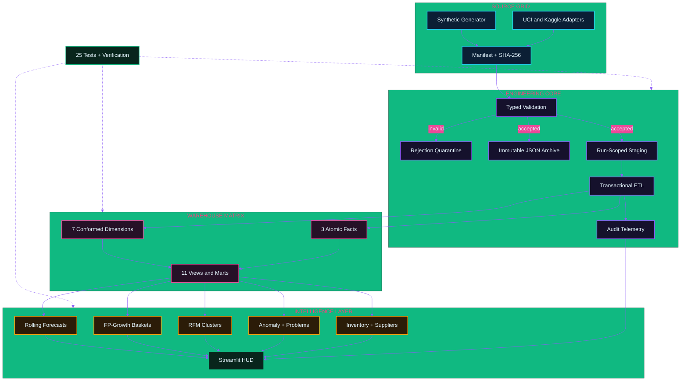
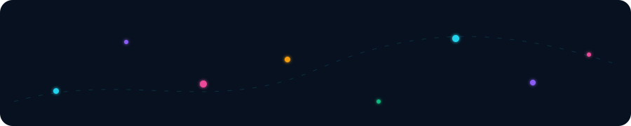

<div align="center">


<br />


<p>
  <a href="https://github.com/manikanta-manjunath/retail-intelligence-data-warehouse/stargazers"></a>
  <a href="https://github.com/manikanta-manjunath/retail-intelligence-data-warehouse/network/members"></a>
  <a href="#-tech-stack"></a>
  <a href="#-testing--verification"></a>
  <a href="#-live-demo--visual-intelligence"></a>
  <a href="docs/STUDENT_LEARNING_REPORT.md"></a>
  <a href="docs/STUDENT_LEARNING_PRESENTATION.md"></a>
  <a href="LICENSES_AND_DATA_SOURCES.md"></a>
</p>

<p>
  <a href="#-overview"><strong>OVERVIEW</strong></a>
  <code>◆</code>
  <a href="#-system-capabilities"><strong>CAPABILITIES</strong></a>
  <code>◆</code>
  <a href="#-architecture"><strong>ARCHITECTURE</strong></a>
  <code>◆</code>
  <a href="#-getting-started"><strong>DEPLOY</strong></a>
  <code>◆</code>
  <a href="wiki/index.md"><strong>DOCS</strong></a>
  <code>◆</code>
  <a href="docs/STUDENT_LEARNING_REPORT.md"><strong>REPORT</strong></a>
  <code>◆</code>
  <a href="docs/STUDENT_LEARNING_PRESENTATION.md"><strong>PRESENTATION</strong></a>
</p>

<sub><code>SYS.STATUS: VERIFIED</code> · <code>WAREHOUSE: 2010–2024</code> · <code>MODE: EDUCATIONAL</code></sub>

</div>


## Quick Navigation

| Scene | Destination | Scene | Destination |
| --- | --- | --- | --- |
| `01` | [Overview](#-overview) | `09` | [Usage](#-usage) |
| `02` | [Academic Deliverables](#-academic-deliverables) | `10` | [Project Structure](#-project-structure) |
| `03` | [System Capabilities](#-system-capabilities) | `11` | [Testing](#-testing--verification) |
| `04` | [Live Demo](#-live-demo--visual-intelligence) | `12` | [Roadmap](#-roadmap) |
| `05` | [Tech Stack](#-tech-stack) | `13` | [Team](#-team) |
| `06` | [Architecture](#-architecture) | `14` | [Contributing](#-contributing) |
| `07` | [Workflow](#-workflow-timeline) | `15` | [License](#-license) |
| `08` | [Getting Started](#-getting-started) | `16` | [Project Wiki](wiki/index.md) |


## 🌌 Overview

<table>
  <tr>
    <td width="62%" valign="top">
      <h3>Retail analytics engineered like a mission-control system.</h3>
      <p><strong>Retail Intelligence</strong> is a Walmart-inspired educational data-engineering and analytics platform built with SQL Server 2022, Python and Streamlit. It authenticates source files, validates business rules, preserves immutable lineage, loads a dimensional warehouse and produces reproducible analytics through a seven-tab decision-support dashboard.</p>
      <p>The platform exists to demonstrate that trustworthy analytics requires more than a model or chart. Source provenance, fact grain, history, reconciliation, chronological evaluation, testing and transparent limitations are treated as one connected system.</p>
      <p><strong>Domain:</strong> retail operations, data warehousing, business intelligence and applied data mining.</p>
    </td>
    <td width="38%" align="center" valign="middle">
      
    </td>
  </tr>
</table>

### Verified telemetry

| Signal | Verified value | Signal | Verified value |
| --- | ---: | --- | ---: |
| Calendar coverage | **2010-01-01 → 2024-12-31** | Product dimension | **150 products** |
| Sales lines | **182,176** | Inventory snapshots | **18,000** |
| Transactions | **73,213** | Shipment facts | **4,800** |
| Reconciled net sales | **16,976,377.1400** | Repeat-load duplicates | **0** |
| Forecast backtest WAPE | **12.96% ± 3.63%** | Unseen-test WAPE | **15.26%** |
| Review problems | **6,239** | Automated tests | **25 / 25** |

> [!IMPORTANT]
> The canonical warehouse contains deterministic synthetic educational data, not Walmart internal data. Forecast, association, clustering and anomaly metrics demonstrate the workflow and do not establish production performance.

<details>
<summary><strong>Open the six-color visual system</strong></summary>

| Role | Name | Hex | Meaning |
| --- | --- | --- | --- |
| Dark base | Warehouse Void | `#07111F` | Persistent historical storage and deep-space HUD surface |
| Primary | Signal Cyan | `#22D3EE` | Data movement, lineage and active telemetry |
| Secondary | Predictive Violet | `#8B5CF6` | Forecasting, models and analytical depth |
| Accent 1 | Demand Magenta | `#EC4899` | Customer behavior, baskets and mining signals |
| Accent 2 | Inventory Amber | `#F59E0B` | Stock, supplier and operational attention |
| Success | Verified Emerald | `#10B981` | Reconciliation, tests and trusted state |

</details>


## 🎓 Academic Deliverables

<table>
  <tr>
    <td width="50%" align="center" valign="top">
      <h3>📘 Professional 30-Page Report</h3>
      <p>A detailed A4-ready self-learning and teamwork report containing <strong>14,000+ words</strong>, explicit page breaks, verified preprocessing examples, ten Mermaid diagrams, warehouse design, ETL, analytics, testing, teamwork, limitations, reflection and reproduction guidance.</p>
      <a href="docs/STUDENT_LEARNING_REPORT.md">
        
      </a>
    </td>
    <td width="50%" align="center" valign="top">
      <h3>🎞️ Six-Slide Presentation</h3>
      <p>A Marp-compatible Markdown presentation covering the retail problem, system architecture, 48-hour learning process, verified analytical results, dashboard decision support and future roadmap.</p>
      <a href="docs/STUDENT_LEARNING_PRESENTATION.md">
        
      </a>
    </td>
  </tr>
</table>

<div align="center">
  <a href="docs/VERIFICATION_REPORT.md"><strong>Verification Report</strong></a>
  <code>◆</code>
  <a href="wiki/index.md"><strong>Project Wiki</strong></a>
  <code>◆</code>
  <a href="docs/ARCHITECTURE.md"><strong>Architecture Reference</strong></a>
</div>


## ⚡ System Capabilities

<table>
  <tr>
    <td width="33%" valign="top"><h3>🔐 Source Lock</h3><p>Manifest declarations, row counts and SHA-256 hashes are checked before parsing or warehouse mutation.</p></td>
    <td width="33%" valign="top"><h3>🧱 Dimensional Core</h3><p>Seven conformed dimensions, three atomic facts and SCD Type 2 product history preserve analytical meaning.</p></td>
    <td width="33%" valign="top"><h3>♻️ Replay Safety</h3><p>Run-scoped staging, immutable archives, transactional loading and unique grains produce zero duplicate facts on replay.</p></td>
  </tr>
  <tr>
    <td width="33%" valign="top"><h3>📡 Predictive Signal</h3><p>Five rolling-origin folds and an untouched 12-week test protect weekly forecasting from temporal leakage.</p></td>
    <td width="33%" valign="top"><h3>🛒 Basket Radar</h3><p>FP-Growth exposes product affinities through support, confidence and lift across 73,213 baskets.</p></td>
    <td width="33%" valign="top"><h3>👥 Customer Matrix</h3><p>RFM K-means profiles customer recency, frequency and monetary behavior with silhouette evaluation.</p></td>
  </tr>
  <tr>
    <td width="33%" valign="top"><h3>🚨 Anomaly Watch</h3><p>Chronological Isolation Forest evaluation is combined with explainable operational problem rules.</p></td>
    <td width="33%" valign="top"><h3>📦 Operations Grid</h3><p>Inventory ABC/XYZ, promotion comparison and supplier scorecards surface stock and delivery risk.</p></td>
    <td width="33%" valign="top"><h3>✅ Evidence Chain</h3><p>Twenty-five tests, verification queries, JSON evidence and linked documentation support every major claim.</p></td>
  </tr>
</table>

<div align="center">
  
</div>

<details>
<summary><strong>Capability boundaries and responsible interpretation</strong></summary>

- Injected anomaly labels represent high-quantity cases only; they do not represent fraud.
- Embedded product affinities make basket rules demonstration evidence rather than an independent consumer discovery.
- Promotion comparisons are descriptive and do not establish causal lift.
- Customer identifiers and cluster profiles are generated.
- Inventory covers a smaller product, store and date subset than the fifteen-year sales history.
- Public UCI and Kaggle datasets are normalised into source-specific outputs and are not silently mixed into canonical facts.

</details>


## 🎬 Live Demo / Visual Intelligence

<div align="center">
  
  <p><sub><code>DEMO.FEED</code> Executive KPIs → forecasting → mining → inventory → problems → ETL audit</sub></p>
</div>

### Feature-preview carousel

<table>
  <tr>
    <td width="33%" align="center" valign="top">
      
      <br /><strong>Forecast Command</strong><br /><sub>Backtests, unseen metrics and future weekly trajectory</sub>
    </td>
    <td width="33%" align="center" valign="top">
      
      <br /><strong>Mining Matrix</strong><br /><sub>Association rules, RFM clusters and anomaly evidence</sub>
    </td>
    <td width="33%" align="center" valign="top">
      
      <br /><strong>ETL Telemetry</strong><br /><sub>Run status, reconciliation and repeat-load evidence</sub>
    </td>
  </tr>
</table>

### Screenshots

<table>
  <tr>
    <td width="50%" align="center"><br /><strong>Executive HUD</strong></td>
    <td width="50%" align="center"><br /><strong>Problem Radar</strong></td>
  </tr>
</table>

<div align="center">
  
  <p><sub><code>ARCH.FLOW</code> Source authentication → warehouse → analytics → dashboard</sub></p>
</div>

> The repository currently provides a local Streamlit experience. The GIF and screenshot paths are intentionally reserved for the final visual captures listed in the asset checklist.


## 🧬 Tech Stack

<div align="center">
  
</div>

### Data and engineering

<p align="center">
  
  
  
  
</p>

### Analytics and experience

<p align="center">
  
  
  
  
  
</p>

### Quality and documentation

<p align="center">
  
  
  
  
</p>


## 🛰️ Architecture

<div align="center">
  
</div>



<details>
<summary><strong>Open warehouse schemas and grains</strong></summary>

| Schema | Mission |
| --- | --- |
| `raw` | Current accepted source state and immutable original-row archives |
| `stg` | Typed records isolated by `ETLRunID` |
| `dw` | Conformed dimensions, SCD history and atomic facts |
| `mart` | Business summaries and model-ready views |
| `audit` | Runs, manifests, rejections, data quality and synthetic labels |

| Fact | Atomic grain |
| --- | --- |
| `dw.FactSales` | One product line in one transaction |
| `dw.FactInventorySnapshot` | One product, store and snapshot date |
| `dw.FactShipment` | One supplier shipment |

Read [Architecture](docs/ARCHITECTURE.md), [Warehouse Model](wiki/data-model.md) and [ETL Pipeline](wiki/etl-pipeline.md).

</details>


## ⏱️ Workflow Timeline

```mermaid
%%{init: {'theme':'base','themeVariables': {'background':'#07111F','primaryColor':'#0B1F35','primaryTextColor':'#E6F7FF','primaryBorderColor':'#22D3EE','lineColor':'#8B5CF6','fontFamily':'monospace'}}}%%
flowchart LR
    A["01 AUTHENTICATE<br/>manifest hashes counts"] --> B["02 VALIDATE<br/>types ranges references"]
    B --> C["03 ARCHIVE<br/>original JSON rows"]
    C --> D["04 STAGE<br/>ETL run isolation"]
    D --> E["05 LOAD<br/>dimensions and facts"]
    E --> F["06 RECONCILE<br/>grains formulas totals"]
    F --> G["07 ANALYSE<br/>forecast mine detect"]
    G --> H["08 PRESENT<br/>filter-aware dashboard"]
    H --> I["09 VERIFY<br/>tests evidence limits"]

    classDef c1 fill:#0B1F35,stroke:#22D3EE,color:#E6F7FF;
    classDef c2 fill:#15112C,stroke:#8B5CF6,color:#E6F7FF;
    classDef c3 fill:#261127,stroke:#EC4899,color:#E6F7FF;
    classDef c4 fill:#2B1C08,stroke:#F59E0B,color:#E6F7FF;
    classDef c5 fill:#08251C,stroke:#10B981,color:#E6F7FF;
    class A,B c1;
    class C,D c2;
    class E,F c3;
    class G,H c4;
    class I c5;
```




## 🚀 Getting Started

### Prerequisites

- Python **3.11+**
- Docker with Compose
- Git
- Approximately **1 GB** for the environment and reproducible artifacts
- Ports **1433** and **8501** available locally

### Mission launch

```bash
git clone https://github.com/manikanta-manjunath/retail-intelligence-data-warehouse.git
cd retail-intelligence-data-warehouse

cp .env.example .env
python3 -m venv .venv
.venv/bin/pip install -r requirements.txt

docker compose up -d
.venv/bin/python -m src.cli setup
.venv/bin/python -m src.cli generate --mode small --seed 42 --output data/synthetic/small_seed42
.venv/bin/python -m src.cli etl --input data/synthetic/small_seed42
.venv/bin/python -m src.cli verify
.venv/bin/python -m src.cli analytics
./run_dashboard.sh
```

Open [http://localhost:8501](http://localhost:8501).

<details>
<summary><strong>Full installation and configuration sequence</strong></summary>

### Configure secrets

```bash
cp .env.example .env
```

Set a strong `SQL_PASSWORD` in `.env`. Never commit the file. A password change in Compose does not alter the credential inside an already-initialised SQL Server volume.

### Build the Python environment

```bash
python3 -m venv .venv
.venv/bin/python -m pip install --upgrade pip
.venv/bin/pip install -r requirements.txt
```

### Start SQL Server

```bash
docker compose up -d
docker ps --filter name=retail_intelligence_dw
```

### Create non-destructive database objects

```bash
.venv/bin/python -m src.cli setup
```

The setup allowlist excludes reset, SCD demonstration and reporting-query scripts.

### Generate, load, verify and analyse

```bash
.venv/bin/python -m src.cli generate \
  --mode small \
  --seed 42 \
  --output data/synthetic/small_seed42

.venv/bin/python -m src.cli etl \
  --input data/synthetic/small_seed42

.venv/bin/python -m src.cli verify
.venv/bin/python -m src.cli analytics
.venv/bin/streamlit run dashboard/app.py
```

</details>

<details>
<summary><strong>Build the complete 2010–2024 warehouse</strong></summary>

```bash
.venv/bin/python -m src.cli generate \
  --mode historical_15y \
  --seed 42 \
  --output data/synthetic/historical_2010_2022_seed42

.venv/bin/python -m src.cli etl \
  --input data/synthetic/historical_2010_2022_seed42

.venv/bin/python -m src.cli verify
.venv/bin/python -m src.cli analytics
```

Historical business keys use safe prefixes so the extension does not overwrite later source records.

</details>


## 🎛️ Usage

| Command channel | Instruction |
| --- | --- |
| Initialise warehouse | `.venv/bin/python -m src.cli setup` |
| Generate source data | `.venv/bin/python -m src.cli generate --mode small --seed 42 --output data/synthetic/small_seed42` |
| Run audited ETL | `.venv/bin/python -m src.cli etl --input data/synthetic/small_seed42` |
| Verify warehouse | `.venv/bin/python -m src.cli verify` |
| Generate analytics | `.venv/bin/python -m src.cli analytics` |
| Launch HUD | `./run_dashboard.sh` |
| Execute all tests | `.venv/bin/python -m pytest -q tests` |
| Execute non-SQL tests | `.venv/bin/python -m pytest -q tests -m "not integration"` |

<details>
<summary><strong>Public-source adapter commands</strong></summary>

### UCI Online Retail

```bash
.venv/bin/python -m src.cli adapt-public \
  --dataset uci-online-retail \
  --primary /path/to/online_retail.xlsx \
  --output data/processed/uci-online-retail
```

### Walmart weekly forecasting data

```bash
.venv/bin/python -m src.cli adapt-public \
  --dataset walmart-weekly \
  --primary /path/to/train.csv \
  --features /path/to/features.csv \
  --stores /path/to/stores.csv \
  --output data/processed/walmart-weekly
```

- [UCI Online Retail II](https://archive.ics.uci.edu/dataset/502/online+retail+ii) — CC BY 4.0.
- [UCI Online Retail](https://archive.ics.uci.edu/dataset/352/online+retail) — CC BY 4.0.
- [Walmart Recruiting — Store Sales Forecasting](https://www.kaggle.com/competitions/walmart-recruiting-store-sales-forecasting/data) — Kaggle terms apply.

Original public downloads belong under `data/raw/public/`, which is ignored by Git.

</details>

<details>
<summary><strong>Operational safety console</strong></summary>

- Do not run `sql/13_reset_demo_data.sql` against data you need.
- Dashboard forecasts require at least 128 complete weeks for the current configuration.
- Anomaly flags require human review and do not establish fraud.
- Promotion comparisons are descriptive, not causal.
- UCI, Kaggle and synthetic sources must remain visibly separated.
- Every analytical report records a warehouse signature and limitation statements.

</details>


## 🗂️ Project Structure

```text
retail-intelligence-data-warehouse/
├── assets/                     # Animated HUD SVGs and visual captures
├── config/                     # Application and model configuration
├── dashboard/
│   └── app.py                  # Seven-tab Streamlit command centre
├── data/                       # Generated and public-source workspaces
├── docs/
│   ├── ARCHITECTURE.md
│   ├── STUDENT_LEARNING_REPORT.md
│   ├── STUDENT_LEARNING_PRESENTATION.md
│   └── VERIFICATION_REPORT.md
├── models/                     # Reproducible trained-model outputs
├── reports/generated/          # ETL verification and analytics evidence
├── sql/                        # Database schemas dimensions facts marts and reliability
├── src/
│   ├── analytics/              # Forecasting mining and problem detection
│   ├── db/                     # SQL Server connection and script execution
│   ├── etl/                    # Validation loading and verification
│   ├── ingestion/              # Synthetic generator and public adapters
│   ├── utils/                  # Configuration and logging
│   └── cli.py                  # Project command interface
├── tests/                      # Twenty-five automated tests
├── wiki/                       # Interlinked project documentation
├── docker-compose.yml
├── requirements.txt
└── run_dashboard.sh
```


## 🧪 Testing & Verification

```bash
.venv/bin/python -m pytest -q tests
.venv/bin/python -m pytest -q tests -m "not integration"
.venv/bin/python -m src.cli verify
```

| Integrity channel | Verified status |
| --- | --- |
| Fact-grain duplicates | `0` |
| Orphaned sales facts | `0` |
| Sales formula errors | `0` |
| Product-history overlaps | `0` |
| Temporal product-join errors | `0` |
| Calendar gaps | `0` |
| Source-count differences | `0` |
| Source sales-amount differences | `0` |

<div align="center">

<picture>
  <source media="(prefers-color-scheme: dark)" srcset="https://github-readme-stats.vercel.app/api/pin/?username=manikanta-manjunath&amp;repo=retail-intelligence-data-warehouse&amp;theme=transparent&amp;title_color=22D3EE&amp;text_color=E6F7FF&amp;icon_color=F59E0B&amp;border_color=8B5CF6&amp;bg_color=07111F" />
  <source media="(prefers-color-scheme: light)" srcset="https://github-readme-stats.vercel.app/api/pin/?username=manikanta-manjunath&amp;repo=retail-intelligence-data-warehouse&amp;theme=transparent&amp;title_color=6D28D9&amp;text_color=07111F&amp;icon_color=D97706&amp;border_color=0891B2&amp;bg_color=F8FAFC" />
  
</picture>

<picture>
  <source media="(prefers-color-scheme: dark)" srcset="https://github-readme-activity-graph.vercel.app/graph?username=manikanta-manjunath&amp;bg_color=07111F&amp;color=22D3EE&amp;line=8B5CF6&amp;point=F59E0B&amp;area_color=EC4899&amp;area=true&amp;hide_border=true" />
  <source media="(prefers-color-scheme: light)" srcset="https://github-readme-activity-graph.vercel.app/graph?username=manikanta-manjunath&amp;bg_color=F8FAFC&amp;color=0E7490&amp;line=6D28D9&amp;point=D97706&amp;area_color=DB2777&amp;area=true&amp;hide_border=true" />
  
</picture>

</div>

Evidence files:

- [Warehouse verification JSON](reports/generated/warehouse_verification.json)
- [Analytics report JSON](reports/generated/analytics/analytics_report.json)
- [ETL run evidence](reports/generated/)
- [Human-readable verification report](docs/VERIFICATION_REPORT.md)


## 🗺️ Roadmap

<div align="center">
  
</div>

- [x] Authenticated canonical ingestion
- [x] Immutable source-row archive and rejection quarantine
- [x] Fifteen-year warehouse coverage
- [x] Conformed dimensions and atomic facts
- [x] Idempotent historical replay
- [x] Rolling-origin forecasting and unseen test
- [x] Association mining, RFM clustering and anomaly review
- [x] Filter-aware seven-tab dashboard
- [x] Twenty-five tests and machine-readable verification
- [x] Professional report and six-slide presentation
- [ ] Load UCI and Walmart sources into provenance-preserving marts
- [ ] Add forecast confidence intervals and segment-level evaluation
- [ ] Add category-specific anomaly models and review-outcome logging
- [ ] Add GitHub Actions for automated quality gates
- [ ] Add authentication, role-based views and secret management
- [ ] Publish a hosted synthetic-data demonstration
- [ ] Monitor data freshness, ETL duration and model drift



## 👥 Team

<div align="center">

<table>
  <tr>
    <td align="center" width="50%">
      <a href="https://github.com/manikanta-manjunath">
        
        <br /><strong>MANIKANTA M</strong>
      </a>
      <br /><sub><code>1GA24CI069</code></sub>
      <br /><sub>Student Contributor</sub>
    </td>
    <td align="center" width="50%">
      
      <br /><strong>CHINMAY GOWDA J</strong>
      <br /><sub><code>1GA24CI0XX</code></sub>
      <br /><sub>Student Contributor · GitHub link pending</sub>
    </td>
  </tr>
</table>

</div>


## 🤝 Contributing

Contributions that improve correctness, reproducibility, accessibility or source transparency are welcome.

1. Fork the repository.
2. Create a focused branch: `git switch -c feature/your-change`.
3. Make the change without committing `.env`, credentials or downloaded public datasets.
4. Run `.venv/bin/python -m pytest -q tests`.
5. Run `.venv/bin/python -m src.cli verify` when warehouse behavior changes.
6. Update documentation and generated evidence when a claim changes.
7. Open a pull request describing the problem, implementation, validation and limitations.

<details>
<summary><strong>Contribution gate checklist</strong></summary>

- [ ] Fact grains and provenance remain explicit.
- [ ] Synthetic, UCI and Kaggle sources remain separated.
- [ ] New ETL behavior is idempotent or documents its retry semantics.
- [ ] Time-series evaluation remains chronological.
- [ ] Model metrics include limitations.
- [ ] New behavior has automated coverage.
- [ ] Markdown links and Mermaid diagrams render.
- [ ] No credentials or raw public downloads are committed.

</details>


## 📄 License

This repository is an **educational project** and does not currently declare one blanket open-source software licence for every file.

- Synthetic project data is generated for demonstration and testing.
- UCI datasets remain governed by their published CC BY 4.0 terms and attribution requirements.
- Walmart competition data remains governed by the current Kaggle rules.
- Third-party libraries retain their respective licences.

Review [LICENSES_AND_DATA_SOURCES.md](LICENSES_AND_DATA_SOURCES.md) before redistributing code, data or generated artifacts.


<div align="center">

### `[ TRANSMISSION COMPLETE ]`

<h3>If this repository helped you learn, illuminate the signal with a ⭐</h3>

<a href="https://github.com/manikanta-manjunath/retail-intelligence-data-warehouse">
  
</a>

<br /><br />

<sub><code>BUILD.TRANSPARENT</code> · <code>DATA.REPRODUCIBLE</code> · <code>CLAIMS.VERIFIED</code></sub>


</div>
