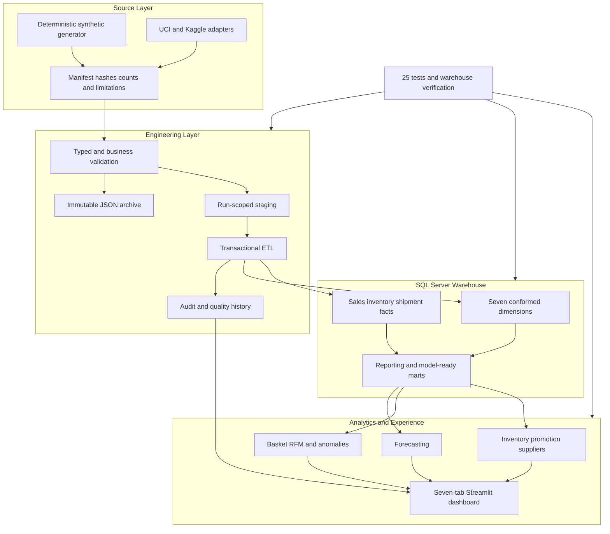

<div align="center">


<p>
  <a href="https://github.com/manikanta-manjunath/retail-intelligence-data-warehouse/stargazers"></a>
  <a href="https://github.com/manikanta-manjunath/retail-intelligence-data-warehouse/network/members"></a>
  <a href="https://github.com/manikanta-manjunath/retail-intelligence-data-warehouse"></a>
  <a href="#-testing--verification"></a>
  <a href="#-demo--screenshots"></a>
  <a href="LICENSES_AND_DATA_SOURCES.md"></a>
</p>

<p>
  <a href="#-getting-started"><strong>Get Started</strong></a>
  ·
  <a href="wiki/index.md"><strong>Documentation</strong></a>
  ·
  <a href="docs/STUDENT_LEARNING_REPORT.md"><strong>30-Page Report</strong></a>
  ·
  <a href="docs/STUDENT_LEARNING_PRESENTATION.md"><strong>Presentation</strong></a>
  ·
  <a href="docs/VERIFICATION_REPORT.md"><strong>Verified Results</strong></a>
</p>

<sub>Palette: <code>#0F172A</code> · <code>#22D3EE</code> · <code>#7C3AED</code></sub>

</div>

---

## Table of Contents

- [Overview](#-overview)
- [Features](#-features)
- [Demo and Screenshots](#-demo--screenshots)
- [Tech Stack](#-tech-stack)
- [Architecture](#-architecture)
- [Getting Started](#-getting-started)
- [Usage](#-usage)
- [Project Structure](#-project-structure)
- [Testing and Verification](#-testing--verification)
- [Roadmap](#-roadmap)
- [Team](#-team)
- [Contributing](#-contributing)
- [License](#-license)


## 🌐 Overview

**Retail Intelligence** is a Walmart-inspired educational data-engineering and analytics platform built with Microsoft SQL Server 2022, Python and Streamlit. It turns authenticated source files into an audited dimensional warehouse, reproducible analytical artifacts and an interactive decision-support dashboard.

The project exists to demonstrate how data provenance, validation, ETL, warehouse modelling, forecasting, mining, testing and presentation work together. The canonical warehouse contains deterministic synthetic educational data—not Walmart internal data—and every reported result is tied to verification evidence.

### Verified project snapshot

| Metric | Verified value |
| --- | ---: |
| Historical coverage | **2010-01-01 → 2024-12-31** |
| Sales lines | **182,176** |
| Transactions | **73,213** |
| Reconciled net sales | **16,976,377.1400** |
| Inventory snapshots | **18,000** |
| Shipment facts | **4,800** |
| Repeat-ETL duplicate facts | **0** |
| Forecast backtest WAPE | **12.96% ± 3.63%** |
| Unseen-test WAPE | **15.26%** |
| Automated tests | **25 / 25 passing** |

> [!IMPORTANT]
> Forecast, clustering, association and anomaly results are generated-data demonstrations. Anomaly precision and recall apply only to authenticated injected high-quantity labels and must not be interpreted as fraud-detection performance.

<div align="center">
  
</div>


## ✨ Features

| | Capability | What it delivers |
| :---: | --- | --- |
| 🔐 | **Authenticated ingestion** | Manifest declarations, row counts and SHA-256 hashes are verified before parsing. |
| 🧱 | **Dimensional warehouse** | Seven conformed dimensions, three atomic facts, SCD Type 2 product history and analytical marts. |
| ♻️ | **Repeatable ETL** | Run-scoped staging, immutable source archives, rejection quarantine, transactions and zero-duplicate replay. |
| 📈 | **Forecasting** | Five rolling-origin folds, an unseen 12-week test and filter-aware weekly forecasts. |
| 🛒 | **Market-basket mining** | FP-Growth rules with support, confidence and lift across 73,213 baskets. |
| 👥 | **Customer intelligence** | RFM K-means clustering with standardised features and silhouette evaluation. |
| 🚨 | **Anomaly review** | Chronological Isolation Forest evaluation plus precision, recall, F1 and explainable problem rules. |
| 📦 | **Operational analytics** | Inventory ABC/XYZ, stock-risk flags, promotion comparison and supplier scorecards. |
| 🖥️ | **Interactive dashboard** | Seven Streamlit tabs, live filters, 20 KPI cards, nine tables and safe short-range forecast behavior. |
| ✅ | **Evidence-driven quality** | Twenty-five automated tests, warehouse assertions, reconciliation and machine-readable reports. |

<details>
<summary><strong>Explore the complete analytical scope</strong></summary>

The project detects or analyses:

- sales trends, profitability, margin and year-over-year decline;
- products, categories, stores and sales channels;
- future weekly sales using leakage-resistant model selection;
- transaction baskets and embedded product affinities;
- customer recency, frequency and monetary profiles;
- stockouts, understock, reorder risk and inventory variability;
- supplier lead time, late deliveries and partial fills;
- excessive discounts, low margins, spikes, drops and missing dates;
- ETL failures, rejected records and data-quality conditions.

</details>


## 🎬 Demo / Screenshots

<div align="center">
  
  <p><sub>Animated walkthrough: executive KPIs → forecasting → customer mining → inventory risk → ETL audit.</sub></p>
</div>

<table>
  <tr>
    <td width="50%" align="center">
      
      <br /><strong>Executive intelligence</strong>
    </td>
    <td width="50%" align="center">
      
      <br /><strong>Forecasting and mining</strong>
    </td>
  </tr>
  <tr>
    <td colspan="2" align="center">
      
      <br /><strong>Warehouse quality and ETL audit</strong>
    </td>
  </tr>
</table>

> The repository currently provides a **local Streamlit demo**. Add the four files listed in the asset checklist after the README to activate these previews.


## 🧰 Tech Stack

<div align="center">
  
</div>

| Layer | Technologies |
| --- | --- |
| **Data platform** | Microsoft SQL Server 2022, T-SQL, Docker Compose |
| **Application** | Python 3.11+, pandas, pyodbc, PyYAML |
| **Analytics** | scikit-learn, statsmodels, mlxtend, joblib |
| **Dashboard** | Streamlit, Plotly |
| **Quality** | pytest, SQL verification queries, reconciliation reports |
| **Documentation** | GitHub Markdown, Mermaid, Marp-compatible presentation |

<p align="center">
  
  
  
  
</p>

## 🏗️ Architecture



<details>
<summary><strong>Warehouse schemas and fact grains</strong></summary>

| Schema | Responsibility |
| --- | --- |
| `raw` | Current accepted source state and immutable original-row archives |
| `stg` | Typed records isolated by `ETLRunID` |
| `dw` | Conformed dimensions, historical product versions and atomic facts |
| `mart` | Business summaries and model-ready views |
| `audit` | Runs, manifests, rejections, data quality and synthetic labels |

| Fact | Grain |
| --- | --- |
| `dw.FactSales` | One product line in one transaction |
| `dw.FactInventorySnapshot` | One product, store and snapshot date |
| `dw.FactShipment` | One supplier shipment |

Read the [architecture reference](docs/ARCHITECTURE.md), [warehouse model](wiki/data-model.md) and [ETL pipeline](wiki/etl-pipeline.md) for field-level behavior.

</details>


## 🚀 Getting Started

### Prerequisites

- Python **3.11+**
- Docker with Compose
- Git
- Approximately **1 GB** for the Python environment and generated artifacts
- Ports **1433** for SQL Server and **8501** for Streamlit

### Quick start

```bash
git clone https://github.com/manikanta-manjunath/retail-intelligence-data-warehouse.git
cd retail-intelligence-data-warehouse

cp .env.example .env
python3 -m venv .venv
.venv/bin/pip install -r requirements.txt

docker compose up -d
.venv/bin/python -m src.cli setup
.venv/bin/python -m src.cli generate --mode small --seed 42 --output data/synthetic/small_seed42
.venv/bin/python -m src.cli etl --input data/synthetic/small_seed42
.venv/bin/python -m src.cli verify
.venv/bin/python -m src.cli analytics
./run_dashboard.sh
```

Open [http://localhost:8501](http://localhost:8501).

<details>
<summary><strong>Full installation and configuration guide</strong></summary>

### 1. Configure the environment

Copy the example environment file and set a strong local SQL Server password:

```bash
cp .env.example .env
```

Edit `SQL_PASSWORD` in `.env`. Do not commit `.env`. If the SQL Server volume already exists, changing only the Compose variable does not change the password stored inside that volume.

### 2. Create the Python environment

```bash
python3 -m venv .venv
.venv/bin/python -m pip install --upgrade pip
.venv/bin/pip install -r requirements.txt
```

### 3. Start and inspect SQL Server

```bash
docker compose up -d
docker ps --filter name=retail_intelligence_dw
```

### 4. Create database objects

```bash
.venv/bin/python -m src.cli setup
```

The setup command is non-destructive. It excludes reset, SCD demonstration and reporting-query scripts.

### 5. Generate and load data

```bash
.venv/bin/python -m src.cli generate \
  --mode small \
  --seed 42 \
  --output data/synthetic/small_seed42

.venv/bin/python -m src.cli etl \
  --input data/synthetic/small_seed42
```

Generation refuses to overwrite an existing generated directory.

### 6. Verify, analyse and launch

```bash
.venv/bin/python -m src.cli verify
.venv/bin/python -m src.cli analytics
.venv/bin/streamlit run dashboard/app.py
```

</details>

<details>
<summary><strong>Generate the complete 2010–2024 warehouse</strong></summary>

Generate the non-overlapping 2010–2022 historical extension:

```bash
.venv/bin/python -m src.cli generate \
  --mode historical_15y \
  --seed 42 \
  --output data/synthetic/historical_2010_2022_seed42
```

Load the historical extension, verify the warehouse and regenerate analytics:

```bash
.venv/bin/python -m src.cli etl \
  --input data/synthetic/historical_2010_2022_seed42

.venv/bin/python -m src.cli verify
.venv/bin/python -m src.cli analytics
```

The historical identifiers use safe prefixes so the extension does not overwrite the existing 2023–2024 source records.

</details>

## 🧭 Usage

| Task | Command |
| --- | --- |
| Create SQL objects | `.venv/bin/python -m src.cli setup` |
| Generate synthetic input | `.venv/bin/python -m src.cli generate --mode small --seed 42 --output data/synthetic/small_seed42` |
| Run ETL | `.venv/bin/python -m src.cli etl --input data/synthetic/small_seed42` |
| Verify warehouse | `.venv/bin/python -m src.cli verify` |
| Run analytics | `.venv/bin/python -m src.cli analytics` |
| Launch dashboard | `./run_dashboard.sh` |
| Run every test | `.venv/bin/python -m pytest -q tests` |
| Run non-integration tests | `.venv/bin/python -m pytest -q tests -m "not integration"` |

<details>
<summary><strong>Public dataset adapters</strong></summary>

The adapters preserve each source’s native grain and do not silently load incompatible records into canonical facts.

### UCI Online Retail or Online Retail II

```bash
.venv/bin/python -m src.cli adapt-public \
  --dataset uci-online-retail \
  --primary /path/to/online_retail.xlsx \
  --output data/processed/uci-online-retail
```

### Walmart weekly store-department sales

```bash
.venv/bin/python -m src.cli adapt-public \
  --dataset walmart-weekly \
  --primary /path/to/train.csv \
  --features /path/to/features.csv \
  --stores /path/to/stores.csv \
  --output data/processed/walmart-weekly
```

Recommended sources:

- [UCI Online Retail II](https://archive.ics.uci.edu/dataset/502/online+retail+ii) — 1,067,371 invoice lines, CC BY 4.0.
- [UCI Online Retail](https://archive.ics.uci.edu/dataset/352/online+retail) — 541,909 invoice lines, CC BY 4.0.
- [Walmart Recruiting — Store Sales Forecasting](https://www.kaggle.com/competitions/walmart-recruiting-store-sales-forecasting/data) — competition terms and Kaggle login required.

Store original downloads under `data/raw/public/`, which is ignored by Git.

</details>

<details>
<summary><strong>Safety rules and common questions</strong></summary>

### Can I run the reset SQL script?

Do not run `sql/13_reset_demo_data.sql` against data you need. It is intentionally excluded from normal setup.

### Why does a short forecast range show an information message?

Dynamic forecasting currently requires at least 128 complete weeks. Shorter filtered periods show a clear notice rather than raising an application error.

### Are the anomalies fraud?

No. Labels cover only deterministic injected high-quantity cases. Large legitimate orders can be flagged, and human review is required.

### Are promotion results causal?

No. Promotion comparisons are descriptive and do not establish causal lift.

### Is the data real Walmart data?

No. The canonical warehouse is deterministic synthetic educational data. Public adapters keep UCI and Kaggle data source-separated.

</details>


## 🗂️ Project Structure

```text
retail-intelligence-data-warehouse/
├── config/                     # Application and model configuration
├── dashboard/
│   └── app.py                  # Seven-tab Streamlit dashboard
├── data/                       # Generated and public source workspaces
├── docs/
│   ├── ARCHITECTURE.md
│   ├── STUDENT_LEARNING_REPORT.md
│   ├── STUDENT_LEARNING_PRESENTATION.md
│   └── VERIFICATION_REPORT.md
├── models/                     # Reproducible trained-model outputs
├── reports/generated/          # ETL, verification and analytics evidence
├── sql/
│   ├── 00_create_database.sql
│   ├── 01_create_schemas.sql
│   ├── 02_create_source_tables.sql
│   ├── 03_create_dimensions.sql
│   ├── 04_create_fact_tables.sql
│   ├── 05_create_constraints_indexes.sql
│   ├── 06_create_etl_procedures.sql
│   ├── 07_create_warehouse_views.sql
│   ├── 08_create_data_marts.sql
│   └── 09-14 verification and reliability SQL
├── src/
│   ├── analytics/              # Forecasting mining and problem detection
│   ├── db/                     # SQL Server connection and script execution
│   ├── etl/                    # Validation loading and verification
│   ├── ingestion/              # Synthetic generator and public adapters
│   ├── utils/                  # Configuration and logging
│   └── cli.py                  # Project command-line interface
├── tests/                      # Twenty-five automated tests
├── wiki/                       # Interlinked project documentation
├── docker-compose.yml
├── requirements.txt
└── run_dashboard.sh
```

## 🧪 Testing & Verification

```bash
# Complete suite, including local SQL Server integration
.venv/bin/python -m pytest -q tests

# Tests that do not require SQL Server
.venv/bin/python -m pytest -q tests -m "not integration"

# Read-only warehouse verification
.venv/bin/python -m src.cli verify
```

| Verification area | Confirmed result |
| --- | --- |
| Fact-grain duplicates | Zero |
| Orphaned sales facts | Zero |
| Sales formula errors | Zero |
| Product-history overlaps | Zero |
| Temporal product-join errors | Zero |
| Calendar gaps | Zero |
| Source-to-fact count differences | Zero |
| Source-to-fact sales amount differences | Zero |

Machine-readable evidence:

- [`reports/generated/warehouse_verification.json`](reports/generated/warehouse_verification.json)
- [`reports/generated/analytics/analytics_report.json`](reports/generated/analytics/analytics_report.json)
- [`reports/generated/etl_run_*.json`](reports/generated/)
- [Human-readable verification report](docs/VERIFICATION_REPORT.md)


## 🗺️ Roadmap

- [x] Audited canonical ingestion and immutable row archive
- [x] Fifteen-year warehouse coverage
- [x] Conformed dimensions and atomic fact tables
- [x] Idempotent historical replay
- [x] Rolling-origin forecast evaluation
- [x] Association rules, RFM clustering and anomaly review
- [x] Filter-aware seven-tab Streamlit dashboard
- [x] Twenty-five automated tests and machine-readable verification
- [x] Professional 30-page academic report and six-slide presentation
- [ ] Load UCI and Walmart sources into provenance-preserving marts
- [ ] Add forecast confidence intervals and segment-level evaluation
- [ ] Add category-specific anomaly models and review-outcome logging
- [ ] Add GitHub Actions for tests, SQL checks and link validation
- [ ] Add authentication, role-based views and secret management
- [ ] Publish a hosted demonstration using non-sensitive synthetic data
- [ ] Add data-freshness, model-drift and ETL-duration monitoring

## 👥 Team

<div align="center">

<table>
  <tr>
    <td align="center" width="50%">
      <a href="https://github.com/manikanta-manjunath">
        
        <br />
        <strong>Manikanta M</strong>
      </a>
      <br />
      <sub>1GA24CI069 · Student contributor</sub>
    </td>
    <td align="center" width="50%">
      
      <br />
      <strong>Chinmay Gowda J</strong>
      <br />
      <sub>1GA24CI0XX · Student contributor</sub>
      <br />
      <sub>GitHub profile link to be added</sub>
    </td>
  </tr>
</table>

</div>

## 🤝 Contributing

Contributions that improve correctness, reproducibility, documentation or accessibility are welcome.

1. Fork the repository.
2. Create a focused branch: `git switch -c feature/your-change`.
3. Make the change without committing private data, `.env` files or downloaded public datasets.
4. Run `.venv/bin/python -m pytest -q tests`.
5. Run `.venv/bin/python -m src.cli verify` when warehouse behavior changes.
6. Update documentation and generated evidence when claims change.
7. Open a pull request describing the problem, solution, validation and limitations.

<details>
<summary><strong>Contribution quality checklist</strong></summary>

- [ ] Fact grains and source provenance remain explicit.
- [ ] Synthetic, UCI and Kaggle data remain visibly separated.
- [ ] New ETL behavior is idempotent or documents why it cannot be.
- [ ] Time-series evaluation preserves chronology.
- [ ] Model results include appropriate metrics and limitations.
- [ ] Tests cover the new behavior.
- [ ] Local Markdown links resolve.
- [ ] No credentials, raw public downloads or sensitive data are committed.

</details>

## 📄 License

This repository is an **educational project**. It does not currently declare one blanket open-source software licence for every file.

- Synthetic project data is generated for demonstration and testing.
- UCI datasets are governed by their published CC BY 4.0 terms and attribution requirements.
- Walmart competition data is governed by the current Kaggle competition rules.
- Third-party libraries retain their own licences.

Review [LICENSES_AND_DATA_SOURCES.md](LICENSES_AND_DATA_SOURCES.md) before redistributing code, data or generated artifacts.

---

<div align="center">

### If this project helped you learn, consider giving it a ⭐

<a href="https://github.com/manikanta-manjunath/retail-intelligence-data-warehouse">
  
</a>

<br /><br />

<sub>Built for transparent, reproducible and responsible retail analytics.</sub>


</div>
