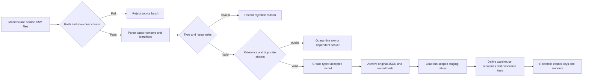
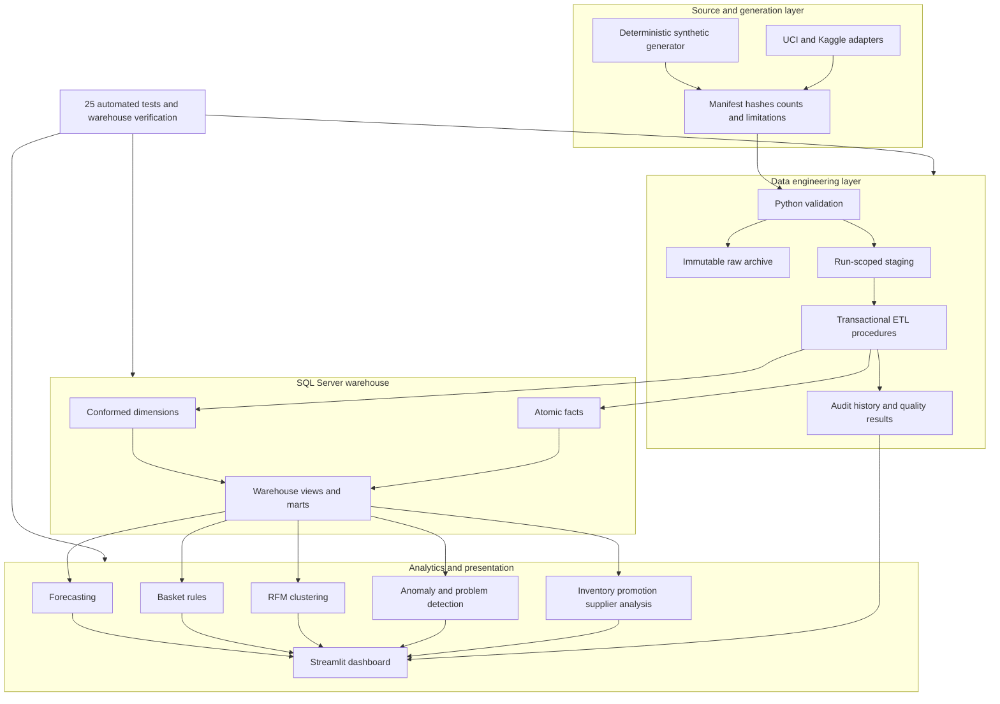
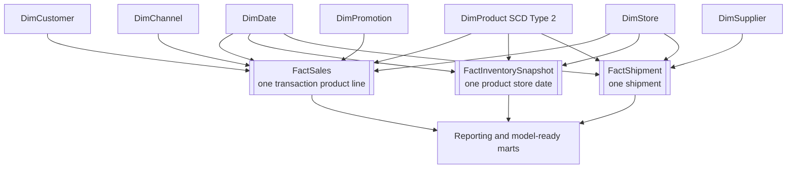
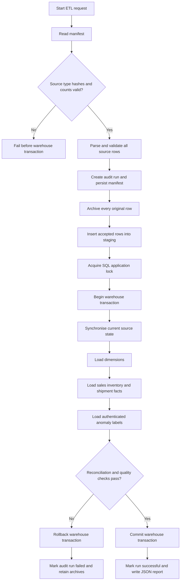
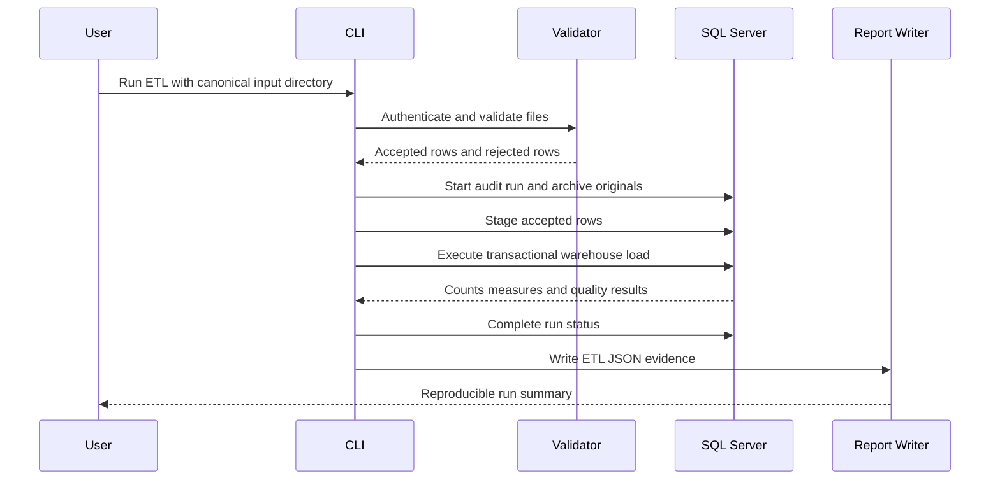
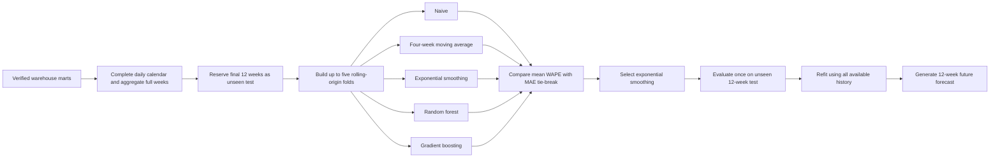
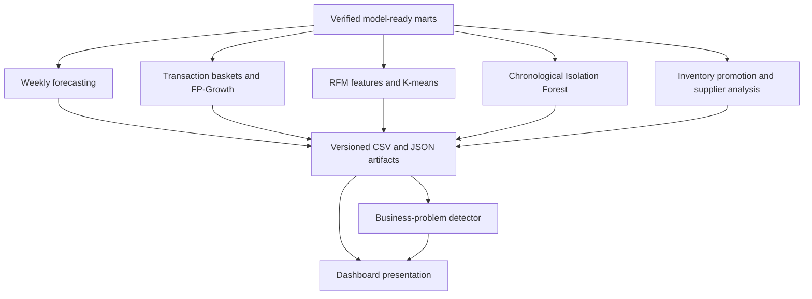
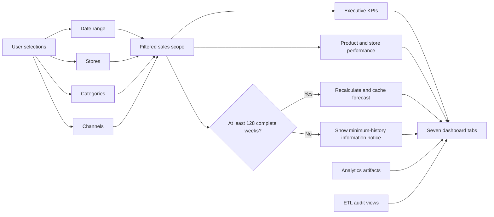
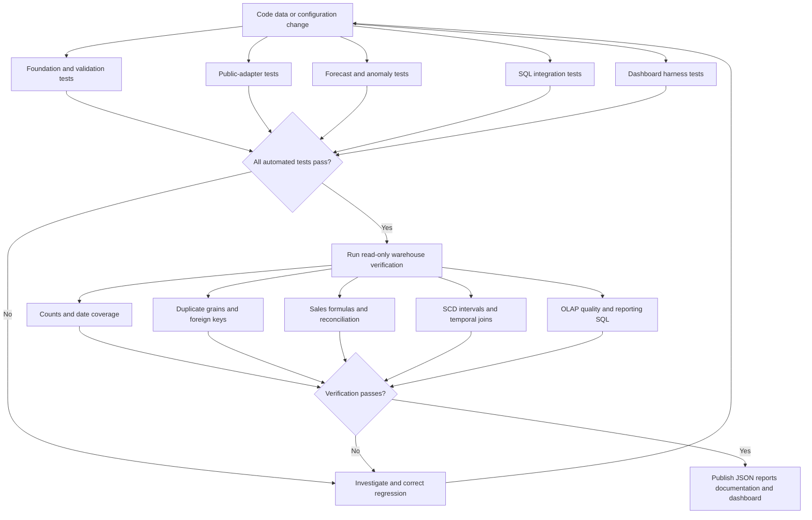
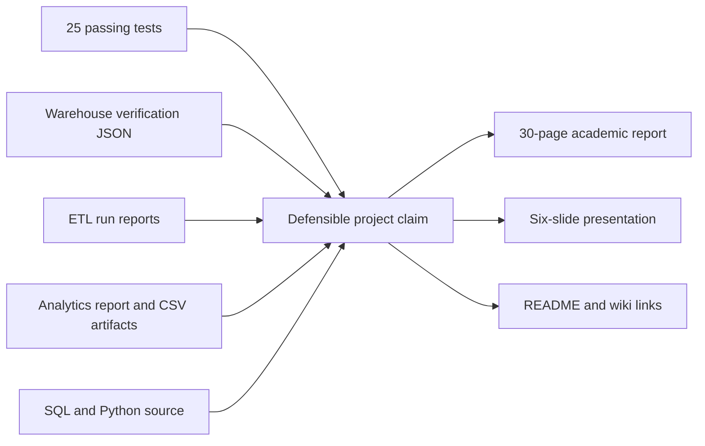

<style>
@media print {
  .page-break { break-after: page; page-break-after: always; }
  table { break-inside: avoid; page-break-inside: avoid; }
  pre, blockquote { break-inside: avoid; page-break-inside: avoid; }
}
</style>

# Self-Learning and Teamwork Report

> **Pagination note:** This Markdown report is organised into exactly 30 explicitly numbered content pages. The page-break markers are designed for A4 printing or PDF export. Physical pagination can vary slightly with the renderer, font and margin settings; use A4 paper, 12-point text and 25 mm margins for the intended layout.

## Page 1 of 30 — Cover Page

### Retail Intelligence Data Warehouse and Analytics Platform

**Course:** Data Mining and Data Warehousing — BCI24505D<br>
**Programme:** Bachelor of Engineering — Computer Science and Engineering (AI & ML)<br>
**Institution:** Global Academy of Technology, Bengaluru<br>
**Academic year:** 2026–2027

| Submitted by | University Seat Number |
| --- | --- |
| Manikanta M | 1GA24CI069 |
| Chinmay Gowda J | 1GA24CI0XX |

**Faculty guide:** Dr. Lokanna Kadakolmath<br>
**Designation:** Associate Professor, Department of CSE (AI & ML)

### Project theme

Design and implementation of a fifteen-year educational retail-intelligence platform using Microsoft SQL Server, Python, data-mining techniques and an interactive Streamlit dashboard.

### Submission statement

This report presents the students’ self-learning, collaborative project work, technical implementation, evaluation results and professional reflection. Technical claims are linked to repository evidence. Synthetic data is identified as synthetic, public datasets are described with their real licensing boundaries, and model scores are not presented as production guarantees.

<div class="page-break"></div>

## Page 2 of 30 — Declaration and Faculty Verification

### Student declaration

We declare that this report accurately represents the self-learning and teamwork activities carried out for the Data Mining and Data Warehousing course. The explanations, implementation evidence and interpretations have been prepared for academic learning. Where the project uses deterministic synthetic data, the report states that limitation directly. Where public datasets are recommended, their sources and compatibility boundaries are identified.

We further declare that:

1. the recorded warehouse and analytical results were taken from the verified project snapshot;
2. the report does not claim access to private Walmart operational data;
3. model metrics are interpreted only within the scope of the generated educational dataset;
4. repository links are provided so that the implementation can be reviewed and reproduced; and
5. signatures, dates and any additional institutional evidence will be completed only by the appropriate student or faculty member.

| Student | USN | Signature | Date |
| --- | --- | --- | --- |
| Manikanta M | 1GA24CI069 | ____________________ | ____________________ |
| Chinmay Gowda J | 1GA24CI0XX | ____________________ | ____________________ |

### Faculty verification

| Verification item | Faculty entry |
| --- | --- |
| Report reviewed | Yes / No |
| Activity hours verified | Yes / No |
| Evidence verified | Yes / No |
| Remarks | ______________________________________________ |
| Faculty signature | ____________________ |
| Date | ____________________ |

<div class="page-break"></div>

## Page 3 of 30 — Acknowledgement

We express our sincere gratitude to Dr. Lokanna Kadakolmath, Associate Professor in the Department of Computer Science and Engineering (AI & ML), for guiding the academic direction of this Data Mining and Data Warehousing activity. The course structure helped us connect concepts such as dimensional modelling, ETL, OLAP, association-rule mining, clustering, forecasting and anomaly evaluation with a complete working system.

We also acknowledge the Department of CSE (AI & ML), Global Academy of Technology, for providing the learning environment in which this case study could be developed. The assignment encouraged us to move beyond isolated algorithms and understand how data provenance, validation, warehouse design, reproducibility, model evaluation and presentation quality fit together in a professional analytics workflow.

The project benefited from openly documented technologies and learning resources. Microsoft SQL Server provided the relational and analytical storage layer; Python libraries supported validation, forecasting and mining; Streamlit provided the dashboard layer; Git and GitHub supported version control and review. The UCI Machine Learning Repository and Kaggle are acknowledged as sources of public retail datasets recommended for future real-data extensions. No claim is made that these public sources are currently loaded into the canonical warehouse.

Finally, we acknowledge the value of teamwork. Shared review of data grains, ETL behavior, model limitations, test results and documentation improved the quality of the outcome. The use of an interlinked repository wiki and repeatable verification commands made the work easier to inspect and explain. This report therefore represents both technical learning and the development of communication, review and professional-responsibility skills.

<div class="page-break"></div>

## Page 4 of 30 — Abstract and Executive Summary

Retail organisations generate sales, inventory, customer, promotion and supplier records at different grains and frequencies. When these records remain separated, decision-makers cannot reliably answer questions about long-term sales performance, profitability, stock risk, product relationships, customer behavior or supplier service. This project addresses that educational problem through a complete retail-intelligence platform built with SQL Server 2022, Python and Streamlit.

The system implements an audited dimensional warehouse with five logical schemas: `raw`, `stg`, `dw`, `mart` and `audit`. Canonical input is authenticated through manifests and SHA-256 hashes, validated against types and business rules, archived as immutable JSON, staged under an ETL run identifier and loaded into seven dimensions and three fact tables. Product history uses Slowly Changing Dimension Type 2 logic. Foreign keys, unique indexes, arithmetic checks and reconciliation queries protect warehouse quality.

The verified snapshot covers 1 January 2010 through 31 December 2024. It contains 182,176 sales lines in 73,213 transactions, 18,000 inventory snapshots and 4,800 shipment facts. Reconciled net sales equal 16,976,377.1400. Replaying the historical load inserts zero duplicate facts, demonstrating idempotent behavior.

The analytical layer includes rolling-origin weekly forecasting, FP-Growth market-basket analysis, RFM K-means clustering, chronological Isolation Forest evaluation, inventory ABC/XYZ analysis, promotion comparison, supplier scorecards and business-problem detection. Exponential smoothing achieved a mean backtest WAPE of 12.96% and unseen-test WAPE of 15.26%. Anomaly evaluation achieved 12.48% precision and 62.24% recall against authenticated synthetic high-quantity labels. The project produced 6,239 review records and passed 25 automated tests. These results demonstrate an integrated learning platform, not production Walmart performance.

### Major contribution of the case study

The project’s main contribution is not any single algorithm. It is the controlled connection between source evidence, warehouse state, analytical output and user-facing interpretation. A manifest identifies the input, an ETL run records processing, reconciliation confirms warehouse totals, a warehouse signature identifies the analytical snapshot, and generated reports preserve model results. This chain allows a reviewer to move from a KPI or model metric back to the responsible code and data-quality evidence. For student learning, this is more valuable than presenting disconnected notebooks because it demonstrates how mining methods operate inside a maintainable information system.

<div class="page-break"></div>

## Page 5 of 30 — Table of Contents

| Page | Section |
| ---: | --- |
| 1 | Cover Page |
| 2 | Declaration and Faculty Verification |
| 3 | Acknowledgement |
| 4 | Abstract and Executive Summary |
| 5 | Table of Contents |
| 6 | Abbreviations, Symbols and Evidence Map |
| 7 | Introduction and Background |
| 8 | Problem Statement, Objectives and Scope |
| 9 | Learning Objectives and Course-Outcome Alignment |
| 10 | Retail Domain and Stakeholder Study |
| 11 | Data-Warehousing and Mining Foundations |
| 12 | Project Methodology and Work Plan |
| 13 | Data Sources, Provenance and Licensing |
| 14 | Synthetic Data Generation and Fifteen-Year Coverage |
| 15 | Data Preprocessing and Validation |
| 16 | System Architecture and Technology Stack |
| 17 | Dimensional Model and Slowly Changing Dimensions |
| 18 | Fact Tables, Marts and OLAP Operations |
| 19 | ETL Pipeline and Transaction Design |
| 20 | Auditability, Reconciliation and Repeatability |
| 21 | Sales Forecasting Methodology and Results |
| 22 | Association-Rule Mining |
| 23 | RFM Customer Clustering |
| 24 | Anomaly Evaluation and Problem Detection |
| 25 | Inventory, Promotion and Supplier Analytics |
| 26 | Streamlit Dashboard and Decision Support |
| 27 | Testing, Verification and Measured Results |
| 28 | Self-Learning, Teamwork and 48-Hour Activity Log |
| 29 | Limitations, Ethics, Real-Data Plan and Roadmap |
| 30 | Reflection, Conclusion, References and Reproduction |

The report is written as a self-contained academic document. Readers who want implementation details can follow the relative links to code, SQL, generated evidence and the project wiki.

<div class="page-break"></div>

## Page 6 of 30 — Abbreviations, Symbols and Evidence Map

### Abbreviations

| Term | Meaning |
| --- | --- |
| BI | Business Intelligence |
| CSV | Comma-Separated Values |
| DMDW | Data Mining and Data Warehousing |
| ETL | Extract, Transform and Load |
| FP-Growth | Frequent-Pattern Growth algorithm |
| KPI | Key Performance Indicator |
| MAE | Mean Absolute Error |
| MASE | Mean Absolute Scaled Error |
| OLAP | Online Analytical Processing |
| RFM | Recency, Frequency and Monetary value |
| RMSE | Root Mean Squared Error |
| SCD | Slowly Changing Dimension |
| SHA-256 | Secure Hash Algorithm with a 256-bit digest |
| SQL | Structured Query Language |
| WAPE | Weighted Absolute Percentage Error |

### Important formulas

- `Gross Sales = Quantity × Unit Price`
- `Net Sales = Gross Sales − Discount Amount`
- `Profit = Net Sales − Cost Amount`
- `WAPE = Σ|Actual − Forecast| ÷ Σ|Actual|`
- `Precision = True Positives ÷ Predicted Positives`
- `Recall = True Positives ÷ Actual Positives`
- `F1 = 2 × Precision × Recall ÷ (Precision + Recall)`

### Primary evidence map

| Evidence | Repository location |
| --- | --- |
| Architecture | [Architecture reference](ARCHITECTURE.md) |
| Verified database and analytics results | [Verification report](VERIFICATION_REPORT.md) |
| Machine-readable warehouse checks | [Warehouse verification JSON](../reports/generated/warehouse_verification.json) |
| Machine-readable analytics results | [Analytics report JSON](../reports/generated/analytics/analytics_report.json) |
| SQL dimensions and facts | [SQL directory](../sql/) |
| ETL and analytics implementation | [Source directory](../src/) |
| Automated tests | [Test directory](../tests/) |
| Dashboard | [Streamlit application](../dashboard/app.py) |
| Topic-based documentation | [Project wiki](../wiki/index.md) |

<div class="page-break"></div>

## Page 7 of 30 — Introduction and Background

Modern retail operations produce large volumes of data from transactions, product catalogues, customer interactions, inventory snapshots, promotions and supplier deliveries. Operational systems are designed to record these events quickly, but analytical work requires a different structure. A manager asking for fifteen years of sales trends, product profitability, stockout risk or supplier delay cannot rely on isolated transaction files without consistent keys, dates, measures and business definitions.

A data warehouse addresses this problem by integrating records into stable dimensions and measurable business facts. Dimensions answer questions such as who, what, where, when and how. Facts record events at an explicitly declared grain. Data-mining methods can then operate on verified analytical datasets rather than uncontrolled spreadsheets. The resulting insights can be presented through a dashboard that supports filtering, comparison and review.

This project uses a Walmart-inspired retail scenario only as an educational domain. The canonical warehouse does not contain private Walmart data. It contains deterministic synthetic records designed to demonstrate warehouse and analytics behavior over 2010–2024. Public UCI and Kaggle datasets are documented separately and are not silently mixed with the canonical warehouse.

The project is important from a learning perspective because it connects several layers that are often studied separately. SQL design alone cannot guarantee trustworthy analytics; data must first be authenticated and validated. A high model score alone is not sufficient; evaluation must prevent leakage and explain label limitations. A dashboard alone is not evidence of correctness; it must be supported by reconciled facts, tests and traceable outputs.

The case study therefore treats retail intelligence as an end-to-end engineering and learning problem. The final platform demonstrates data generation, source authentication, preprocessing, dimensional modelling, ETL, verification, forecasting, mining, anomaly review, interactive visualisation and documentation within one reviewable repository.

### Why fifteen-year coverage matters

Long coverage makes several analytical behaviors visible. It provides enough complete weeks for rolling-origin forecasting, enables year-over-year comparisons and exposes the importance of historical product versions. It also creates a realistic performance challenge: calculations must filter and aggregate thousands of days and hundreds of thousands of lines without losing traceability. At the same time, the report avoids confusing duration with realism. Fifteen generated years provide temporal depth for testing, but they do not automatically reproduce every structural change, economic shock or customer behavior observed in a real market.

### Analytical versus operational processing

An operational system would normally optimise the entry and update of individual orders, stock movements or deliveries. This project’s warehouse optimises historical reading and aggregation. Source identifiers are retained for lineage, but surrogate keys and conformed dimensions organise analysis. Measures are stored at atomic grain and summarised through views. This separation explains why a data warehouse complements rather than simply copies an operational database.

<div class="page-break"></div>

## Page 8 of 30 — Problem Statement, Objectives and Scope

### Problem statement

Retail data commonly exists in separate sales, inventory, product, store, customer, promotion and supplier datasets. Different identifiers, grains and time frequencies make it difficult to calculate reliable long-term trends or apply analytical methods consistently. A weak pipeline may duplicate records during reloads, connect facts to the wrong historical product version, hide invalid inputs or report model results without reproducible evidence.

The project problem is therefore to design a reliable educational platform that can preserve fifteen years of retail history, reconcile source records with warehouse facts, support multiple mining tasks and present results through date-aware interactive views.

### Primary objectives

1. Design conformed dimensions and atomic fact tables with explicit business grains.
2. Implement a manifest-driven ETL process with hash verification, validation, quarantine, staging and audit history.
3. Preserve 2010–2024 sales coverage without destructively replacing existing records.
4. Demonstrate repeatable loading by proving that an identical replay creates no duplicate facts.
5. Implement OLAP queries and reusable reporting marts.
6. Apply forecasting, association mining, clustering and anomaly evaluation using appropriate metrics.
7. Detect operational review conditions such as stockouts, excessive discounts and supplier delays.
8. Build an interactive Streamlit dashboard whose KPIs and forecasts respond to user filters.
9. Document limitations, data provenance and reproducibility honestly.

### Scope

The implemented scope includes seven dimensions, three atomic facts, eleven warehouse or mart views, ten ETL or audit procedures, Python analytics, generated model artifacts and a seven-tab dashboard. Verification covers counts, arithmetic, referential integrity, temporal product joins, date continuity, repeatability and analytical chronology.

The scope does not include production authentication, role-based security, orchestration, a complete returns process, an inventory-movement ledger, a purchase-order lifecycle or deployment as a commercial service. Public-source integration is adapter-based and source-specific; it is not claimed as a completed conformed load.

### Success criteria

| Criterion | Acceptance evidence |
| --- | --- |
| Continuous history | Sales minimum and maximum dates equal 2010-01-01 and 2024-12-31 |
| Correct atomic grains | Verification finds zero duplicate sales, inventory or shipment business keys |
| Reconciled measures | Accepted sales count and amount match warehouse facts |
| Historical accuracy | Product-version intervals do not overlap and temporal fact joins are valid |
| Safe replay | An identical historical batch inserts zero duplicate facts |
| Valid evaluation | Forecast folds and anomaly splits preserve chronological order |
| Usable presentation | All seven dashboard tabs execute without exceptions |
| Reproducibility | Commands, tests, machine-readable reports and documentation are present |

These criteria convert broad objectives into observable conditions. A visually attractive dashboard would not satisfy the project if reconciliation failed, and a strong forecast score would not satisfy it if future records leaked into training.

<div class="page-break"></div>

## Page 9 of 30 — Learning Objectives and Course-Outcome Alignment

### Learning objectives

The self-learning and teamwork activity was designed to achieve the following outcomes:

1. distinguish operational processing from analytical warehousing;
2. define dimensional grains, business keys, surrogate keys and history strategies;
3. apply preprocessing rules for types, ranges, references, duplicates and invalid baskets;
4. understand how staging, transactions, audit tables and reconciliation support ETL reliability;
5. implement roll-up, drill-down, slice, dice and ranking operations;
6. apply FP-Growth, RFM K-means, Isolation Forest and time-series forecasting;
7. select metrics that match the analytical task rather than using one generic accuracy measure;
8. prevent temporal leakage through chronological splits and rolling-origin evaluation;
9. communicate findings through a filter-aware dashboard and professional documentation; and
10. use Git-based review, testing and evidence links to support teamwork.

### Course-outcome mapping

| Course outcome | Project evidence | Learning demonstrated |
| --- | --- | --- |
| C505D.1 — Data warehouse design and OLAP | Seven dimensions, three facts, marts and OLAP SQL | Grain definition, star-schema design and analytical querying |
| C505D.2 — Preprocessing and similarity-ready data | Manifest checks, validation, quarantine and feature preparation | Data quality, transformations and reproducibility |
| C505D.3 — Classification and association techniques | FP-Growth rules and labelled anomaly evaluation | Support, confidence, lift, precision, recall and F1 |
| C505D.4 — Clustering | Four RFM K-means clusters | Standardisation, log transformation and silhouette interpretation |

### Professional skills

The activity also developed skills beyond algorithm execution. Requirements had to be translated into auditable implementation choices. Team members had to review the difference between a generated result and a defensible claim. Documentation had to remain consistent with code and machine-readable reports. These practices reflect professional responsibility because they reduce the risk of misleading stakeholders with unverified numbers.

### Assessment evidence by learning type

| Learning type | Evidence produced |
| --- | --- |
| Conceptual understanding | Architecture explanations, dimensional grains and metric definitions |
| Practical implementation | SQL scripts, Python modules, configuration and dashboard code |
| Analytical reasoning | Model comparison, limitation statements and stakeholder interpretation |
| Verification skill | Test suite, reconciliation, temporal checks and repeat-load evidence |
| Communication skill | README links, wiki pages, six-slide presentation and this report |
| Team skill | Shared review, documented decisions and Git-based change history |

This mapping ensures that learning is assessed through both explanation and working evidence. It also prevents the report from becoming a list of tools without demonstrating why each tool was used.

<div class="page-break"></div>

## Page 10 of 30 — Retail Domain and Stakeholder Study

### Retail business processes

The platform models three central processes. The sales process records one product line within a customer transaction. The inventory process records the position of one product in one store on one date. The shipment process records one supplier delivery event. These processes have different grains and must not be combined into a single table because doing so would create duplicated measures and ambiguous relationships.

### Stakeholders and decisions

| Stakeholder | Typical questions | Relevant project output |
| --- | --- | --- |
| Executive management | Are sales and profit growing? Which areas need attention? | Executive KPIs, trends and problem summary |
| Store manager | Which products or categories perform well in the selected store? | Store and product views with filters |
| Inventory planner | Where are stockouts, understock or unstable-demand items? | Inventory health and ABC/XYZ analysis |
| Marketing analyst | Which products occur together? How did promotions perform? | Basket rules and promotion comparison |
| Customer analyst | Which customer groups differ in recency, frequency and value? | RFM cluster profiles |
| Supplier manager | Which suppliers deliver late or incompletely? | Lead-time, delay and fill-rate scorecards |
| Data engineer | Did the load reconcile and can it be replayed safely? | ETL audit history and verification results |
| Data scientist | Are model metrics chronologically valid and reproducible? | Backtest folds, test metrics and anomaly labels |

### Business questions

The warehouse and analytics layer were designed to answer questions at multiple levels. Long-term questions include the fifteen-year sales trend and year-over-year decline. Tactical questions include category performance, margin behavior, discount concentration and promotion comparison. Operational questions include current stockout rows, below-reorder positions, delayed shipments and failed quality checks. Analytical questions include forecast stability, customer-cluster separation, association-rule strength and anomaly review efficiency.

The stakeholder study influenced design choices. Date, product, store, channel, promotion, customer and supplier dimensions are conformed because several processes need them. Sales remains at line grain so baskets, discount behavior and anomalies are not lost. Inventory and shipment facts remain separate because their event frequencies and measures differ.

### Grain examples

Suppose transaction `TX-100` contains milk, bread and soap. The sales fact stores three rows because price, quantity, cost and discount belong to each product line. The transaction count, however, remains one when calculated using the distinct transaction identifier. If those lines were pre-aggregated to one transaction row, market-basket membership and product-level margin would be lost.

For inventory, one row represents the condition of a product at one store on one date. Loading several intraday movements directly into this snapshot fact would violate its grain. Those movements would require a separate stock-movement fact. Similarly, a shipment row represents a supplier delivery event; splitting it by unrelated sales lines would multiply ordered and received quantities. These examples show why grain is a business contract, not merely a database implementation detail.

### Decision cadence

Executive trends may be reviewed monthly or quarterly, while stockout and delivery problems may require daily attention. Forecasting operates weekly in this implementation because weekly aggregation reduces daily noise and matches the available history. The dashboard therefore combines different decision cadences without pretending that every metric should be refreshed or acted upon at the same frequency.

<div class="page-break"></div>

## Page 11 of 30 — Data-Warehousing and Mining Foundations

### Data warehouse concepts

A data warehouse is subject-oriented, integrated, time-variant and non-volatile. Subject orientation is represented through sales, inventory and supplier delivery. Integration is achieved through conformed dimensions and consistent business definitions. Time variance is preserved through a complete date dimension and product history. Non-volatility is supported by immutable source archives and append-oriented audit records.

The dimensional model follows a star-schema approach. Surrogate keys isolate warehouse relationships from changing source identifiers. Business keys remain available for traceability. The fact-table grain is declared before measures are loaded, preventing mixed-level aggregation. Additive measures such as net sales can be summed across dimensions, while ratios such as margin percentage are calculated from aggregated numerator and denominator values.

### Mining concepts

Association-rule mining discovers item relationships using support, confidence and lift. High confidence alone is insufficient because a commonly purchased consequent can create misleading rules; lift helps compare the rule against independent occurrence.

Clustering is unsupervised. The K-means result is evaluated with silhouette score and interpreted through cluster profiles rather than called classification accuracy. RFM features represent time since last purchase, purchase count and total customer value.

Anomaly detection identifies records that differ from learned patterns. Precision measures how many flagged records match the defined positive label, while recall measures how many labelled positives were found. These metrics are meaningful only in relation to the available label definition.

Time-series forecasting requires order-aware evaluation. Random train/test splitting would allow future patterns to influence earlier predictions. Rolling-origin backtesting instead trains on the past and evaluates later, non-overlapping periods. The final test period remains unseen until model selection is complete.

Together, these foundations shaped the platform: dimensional quality precedes analytics, each method receives task-appropriate features and metrics, and every interpretation includes its data limitations.

### OLTP and warehouse comparison

| Property | Operational processing | Analytical warehouse in this project |
| --- | --- | --- |
| Main purpose | Record current business events | Analyse integrated historical behavior |
| Typical query | Read or update one order | Aggregate many years by several dimensions |
| Data organisation | Process-oriented tables | Conformed dimensions and fact tables |
| History | Often current-state focused | Explicit calendar and product history |
| Write pattern | Frequent small transactions | Controlled batch loading |
| Quality emphasis | Valid individual transaction | Reconciliation, lineage and cross-source consistency |

### Relationship between methods

The mining methods answer different questions and should not be compared as if they compete for one accuracy score. Forecasting estimates future weekly totals. Association mining describes co-occurrence. Clustering creates descriptive customer groups. Isolation Forest prioritises unusual lines. Rule-based detection identifies explainable operational conditions. Combining them creates broader decision support, while keeping their outputs and evaluation criteria separate protects interpretation.

<div class="page-break"></div>

## Page 12 of 30 — Project Methodology and Work Plan

The project followed an evidence-driven lifecycle rather than treating the dashboard as the starting point.

### Phase 1 — Requirement and domain analysis

Retail processes, stakeholders, questions and business grains were identified. The team separated sales lines, inventory positions and shipment events to avoid measure duplication. Requirements were translated into dimensions, facts, marts, analytical tasks and dashboard views.

### Phase 2 — Source and warehouse design

Canonical CSV contracts and a manifest format were defined. SQL schemas were created for source state, staging, warehouse objects, marts and audits. Dimension-history strategies and fact uniqueness guards were selected before loading data.

### Phase 3 — Data generation and preprocessing

Deterministic educational data was generated with declared seeds and date ranges. The loader authenticated hashes, parsed types, enforced rules, resolved references, identified duplicates and quarantined invalid dependencies. Historical records received safe prefixes so they could coexist with later records.

### Phase 4 — ETL and verification

Validated records were archived, staged and loaded inside a controlled warehouse transaction. Row counts and sales amounts were reconciled. Repeat loading, temporal product joins, formulas, constraints and date continuity were verified.

### Phase 5 — Analytics

Weekly forecasting, basket mining, RFM clustering, anomaly evaluation, inventory classification, promotion comparison, supplier scoring and problem detection were run only after warehouse verification passed.

### Phase 6 — Presentation and quality assurance

The Streamlit dashboard integrated filtered KPIs and analytical outputs. Automated tests exercised generation, validation, adapters, forecasting chronology, anomaly metrics, SQL integration and dashboard execution. Documentation and a wiki connected claims to evidence.

This phased method supports reproducibility. If an analytical result appears incorrect, the investigation can move backward from artifact to warehouse snapshot, ETL run, staged records, immutable archive and authenticated source manifest.

### Project risks and controls

| Risk | Control used in the project |
| --- | --- |
| Source file changed after generation | SHA-256 hashes checked before parsing |
| Invalid line contaminates a basket | Dependent basket records quarantined consistently |
| Duplicate facts on replay | Unique grains and idempotent procedures |
| Partial load appears successful | One warehouse transaction and explicit run status |
| Historical facts use current product attributes | SCD Type 2 temporal resolution |
| Forecast leakage | Rolling-origin folds and an untouched test period |
| Anomaly metric overclaim | Authenticated narrow labels and explicit limitations |
| Dashboard hides missing data | Empty-state handling plus separate verification evidence |

The work plan used these risks as review checkpoints. A phase was not considered complete merely because it ran once; it needed evidence that predictable failure modes were controlled.

<div class="page-break"></div>

## Page 13 of 30 — Data Sources, Provenance and Licensing

### Canonical educational source

The currently loaded warehouse uses deterministic synthetic data generated by the project. Each generated directory includes ten canonical CSV files and a `manifest.json`. The manifest records the source system, synthetic status, seed, generation dates, row counts, limitations and SHA-256 file hashes. Historical generation may also include authenticated anomaly-ground-truth records.

Calling the dataset synthetic is important. It enables reproducible testing and controlled anomaly evaluation, but it does not represent actual Walmart performance, customers or suppliers.

### Recommended public datasets

1. [UCI Online Retail II](https://archive.ics.uci.edu/dataset/502/online+retail+ii) contains 1,067,371 invoice lines from a UK non-store retailer between December 2009 and December 2011. It is licensed under CC BY 4.0 and is suitable for basket, RFM, cancellation and invoice-line studies.
2. [UCI Online Retail](https://archive.ics.uci.edu/dataset/352/online+retail) contains 541,909 invoice lines from December 2010 through December 2011 and is also available under CC BY 4.0.
3. [Walmart Recruiting — Store Sales Forecasting](https://www.kaggle.com/competitions/walmart-recruiting-store-sales-forecasting/data) provides weekly department sales for 45 stores with holiday, markdown and economic variables. Access requires a Kaggle account and acceptance of the competition rules.

### Compatibility boundaries

| Source | Native grain | Fields that must not be invented |
| --- | --- | --- |
| UCI Online Retail | Invoice line | Physical stores, inventory, suppliers and complete promotions |
| Walmart Recruiting | Store, department and week | Transactions, baskets, customers, item prices and procurement events |

The project adapters preserve native grains and write source-specific processed outputs. They do not silently force incompatible records into the canonical star schema. This separation protects provenance and prevents an impressive-looking but false integrated dataset.

See [Public dataset documentation](../wiki/public-data.md) and [licenses and source matrix](../LICENSES_AND_DATA_SOURCES.md).

### Canonical source contract

The generated input separates entities and events into files for dates, products, stores, customers, channels, promotions, suppliers, sales lines, inventory snapshots and shipments. This separation makes file-level counts and hashes meaningful. Dimension files describe relatively stable entities, while fact files describe events or periodic positions.

The manifest acts as a contract rather than a simple file list. Before any parsing, the loader checks whether the declared source system is accepted, whether every expected file exists, whether recorded and calculated hashes match and whether file row counts agree with the declaration. A directory that fails authentication is rejected before warehouse mutation. This design prevents a modified or incomplete file set from being treated as the original reproducible dataset.

### Provenance levels

Provenance is preserved at four levels: dataset-level declarations in the manifest, file-level SHA-256 hashes, row-level immutable JSON archives and run-level audit identifiers. Public adapters additionally preserve source-specific identity instead of renaming incompatible records until their origins become unclear.

<div class="page-break"></div>

## Page 14 of 30 — Synthetic Data Generation and Fifteen-Year Coverage

The generator supports controlled educational datasets at several scales, including a historical mode used to extend coverage without replacing the existing 2023–2024 warehouse state. Deterministic seeds make the same input reproducible across runs and Python hash seeds. Date generation accounts for calendar behavior and movable holidays tested by the automated suite.

### Non-destructive historical extension

The historical dataset covers 2010–2022. Safe prefixes distinguish historical business keys from later source keys. This approach preserves the existing facts and dimensions while allowing the combined warehouse to cover 2010-01-01 through 2024-12-31. The date dimension contains 5,479 days, matching fifteen calendar years including leap days.

The historical load accepted 242,809 source records and inserted:

| Historical object | Inserted rows |
| --- | ---: |
| Sales facts | 160,057 |
| Inventory facts | 9,000 |
| Shipment facts | 4,000 |
| Reconciled net sales | 15,098,779.5700 |

After combination with the existing period, the warehouse contains 182,176 sales lines, 73,213 transactions, 18,000 inventory snapshots and 4,800 shipment facts. Total reconciled net sales are 16,976,377.1400.

### Controlled patterns

The generator includes repeatable seasonal, product, customer and operational behavior so that forecasting and mining workflows have analyzable structure. Selected product affinities are embedded intentionally for association-rule demonstration. High-quantity anomaly labels are generated separately and authenticated through the manifest so the anomaly detector cannot simply train on the label field.

These controls are useful for testing but reduce external validity. Embedded associations are demonstration evidence, and injected anomalies represent only one anomaly class. The report therefore treats the generator as a laboratory environment for learning pipeline behavior, not as a simulation proven to match a real retailer.

### Generator consistency rules

Generated sales lines satisfy explicit arithmetic: quantity and unit price determine gross sales, discount reduces gross sales to net sales, and cost is used to calculate profit. Foreign business keys are selected from generated dimension domains. Inventory quantities, reorder points and order quantities remain non-negative. Shipment received quantities and timing fields are generated so fill and delay indicators can be recalculated independently.

Historical prefixes are applied consistently across related business keys. This matters because prefixing only a fact key or only a dimension key would create orphaned references. The tests also execute generation under different Python hash seeds to ensure output does not depend on unordered in-memory iteration.

### Ground-truth separation

Injected anomaly labels are stored in a dedicated ground-truth file rather than embedded as a training feature. Its count and hash appear in the manifest. During ETL, every labelled transaction-line key must resolve to an actual accepted sales record. The audit schema then stores the authenticated label independently of the feature table, making accidental target leakage easier to detect.

<div class="page-break"></div>

## Page 15 of 30 — Data Preprocessing and Validation

Preprocessing begins before warehouse loading. The validator converts source text into typed values and applies business rules consistently. This design prevents invalid strings, out-of-range measures and broken references from reaching SQL procedures as if they were trustworthy records.

### Data-preprocessing workflow graph



### Example source data before preprocessing

The following values are taken from the authenticated historical source files. Blank customer and promotion values are preserved as missing values rather than replaced with invented identities.

| Transaction | Store | Customer | Date | Time | Channel | Declared total |
| --- | --- | --- | --- | --- | --- | ---: |
| HIST-TX-0000001 | STORE-002 | CUST-0419 | 2020-05-19 | 11:52:00 | In-Store | 361.97 |
| HIST-TX-0000002 | STORE-007 | missing | 2014-07-03 | 10:24:00 | In-Store | 109.20 |

| Transaction | Line | Product | Quantity | Unit price | Discount | Source line total | Promotion |
| --- | ---: | --- | ---: | ---: | ---: | ---: | --- |
| HIST-TX-0000001 | 1 | PROD-018 | 1 | 9.48 | 0.00 | 9.48 | missing |
| HIST-TX-0000002 | 1 | PROD-042 | 1 | 116.57 | 17.49 | 99.08 | HIST-PROMO-2014-SUMMER |
| HIST-TX-0000002 | 2 | PROD-131 | 2 | 5.95 | 1.78 | 10.12 | HIST-PROMO-2014-SUMMER |

### Example after typing and derivation

| Transaction line | Parsed timestamp | Gross sales | Discount amount | Net sales | Validation result |
| --- | --- | ---: | ---: | ---: | --- |
| HIST-TX-0000001 / 1 | 2020-05-19 11:52:00 | 9.48 | 0.00 | 9.48 | Accepted |
| HIST-TX-0000002 / 1 | 2014-07-03 10:24:00 | 116.57 | 17.49 | 99.08 | Accepted |
| HIST-TX-0000002 / 2 | 2014-07-03 10:24:00 | 11.90 | 1.78 | 10.12 | Accepted |

For HIST-TX-0000002, the two accepted line totals reconcile to 109.20, matching the transaction header. The missing customer remains anonymous; the pipeline does not manufacture a customer key. Promotion membership is retained because the source provides a valid promotion identifier.

### Inventory preprocessing example

| Snapshot date | Store | Product | On hand | On order | Reorder point | Derived interpretation |
| --- | --- | --- | ---: | ---: | ---: | --- |
| 2022-11-02 | STORE-001 | PROD-001 | 57 | 0 | 26 | Healthy position |
| 2022-11-02 | STORE-001 | PROD-002 | 0 | 26 | 40 | Stockout and below reorder point |
| 2022-11-02 | STORE-001 | PROD-005 | 15 | 44 | 34 | Understock with replenishment on order |

### Validation dimensions

| Validation area | Example control |
| --- | --- |
| Manifest authentication | Source declaration, file presence, row count and SHA-256 match |
| Type validation | Dates, integers, decimals and booleans parse correctly |
| Range validation | Non-negative inventory, valid discount boundaries and sensible quantities |
| Reference validation | Product, store, customer, supplier and promotion keys resolve |
| Key validation | Duplicate immutable keys are detected |
| Basket integrity | A transaction with an invalid dependent line can be quarantined consistently |
| Ground-truth validation | Labelled transaction-line keys must exist and hashes must match |

Rejected rows are not silently discarded. They are written to `audit.RejectedRecord` with reasons and ETL-run context. Original rows, including rejected rows, are stored in `raw.IngestedRecord` as JSON with record hashes. This distinction is valuable: the immutable archive answers what arrived, while staging answers what was accepted for the current run.

### Analytical preprocessing

Forecasting completes daily observations against the date calendar, zero-fills missing sales days where appropriate and aggregates full Monday-based weeks. RFM features are log-transformed and standardised before K-means so large monetary values do not dominate distance. Basket analysis reduces each transaction to distinct product membership. Anomaly analysis selects quantity, unit price, net sales and discount features, performs a chronological split and excludes authenticated positives from training.

The preprocessing strategy shows that cleaning is task-dependent. Warehouse validation protects business correctness, while analytical transformations prepare features without changing the historical meaning of source events.

### Before-and-after preprocessing view

| Input condition | Processing action | Resulting evidence |
| --- | --- | --- |
| Text values representing dates and numbers | Strict parsing with validation errors | Typed staged columns or a rejected-row reason |
| Unknown product or store reference | Reference check fails | Record quarantined instead of creating an orphan |
| Duplicate immutable event key | Duplicate/conflict comparison | Safe no-op for identical data or failure for conflict |
| Invalid sales line in a transaction | Basket dependency handling | Related basket evidence remains internally consistent |
| Missing calendar dates in sales activity | Calendar completion for modelling | Continuous daily series before weekly aggregation |
| Highly skewed RFM values | Log transform and standardisation | Features suitable for distance-based clustering |

### Validation ordering

Authentication occurs before expensive parsing; parsing occurs before reference checks; accepted records are identified before database loading. This order improves clarity because a hash failure is reported as an input-authentication issue rather than appearing later as unexplained row errors. It also reduces unnecessary database work when the source contract is invalid.

Decimal values are handled with controlled numeric semantics during warehouse reconciliation. This avoids using binary floating-point approximations as the final authority for currency totals. Analytical libraries may use floating-point values for modelling, but warehouse sales reconciliation remains based on database-compatible decimal measures.

<div class="page-break"></div>

## Page 16 of 30 — System Architecture and Technology Stack

### End-to-end architecture

```text
Canonical CSV files + manifest
            │
            ▼
SHA-256 authentication and typed validation
            │
            ├── invalid records ──► audit.RejectedRecord
            ▼
raw.IngestedRecord immutable archive
            │
            ▼
Run-scoped staging ──► current raw source state
            │
            ▼
Conformed dimensions and atomic facts
            │
            ▼
Warehouse views and analytical marts
            │
            ├──► Python analytics and generated artifacts
            └──► Streamlit decision-support dashboard
```

### Complete project graph



### SQL schemas

| Schema | Responsibility |
| --- | --- |
| `raw` | Current accepted source state and immutable row archive |
| `stg` | Typed records isolated by `ETLRunID` |
| `dw` | Conformed dimensions, product history and atomic facts |
| `mart` | Business summaries and model-ready views |
| `audit` | Runs, manifests, rejections, quality results and synthetic labels |

### Technology stack

- **Microsoft SQL Server 2022:** relational constraints, transactions, dimensions, facts, procedures and marts.
- **Python:** deterministic generation, adapters, preprocessing, ETL orchestration, analytics and testing.
- **pandas and scientific libraries:** tabular preparation, metrics and model workflows.
- **Streamlit:** interactive dashboard and filtered decision-support views.
- **Docker Compose:** repeatable local SQL Server service configuration.
- **pytest:** automated behavioral and integration tests.
- **Git and GitHub:** source control, review, history and documentation access.

The architecture separates responsibilities instead of allowing one script to perform every operation. SQL protects warehouse invariants close to the data. Python coordinates file processing and models. Generated artifacts preserve analytical results. Streamlit focuses on interaction and presentation. This separation makes failures easier to isolate and components easier to test.

### Component interaction details

| Component | Reads | Writes | Failure visibility |
| --- | --- | --- | --- |
| Generator | Configuration and seed | Canonical files and manifest | Determinism and schema tests |
| Validator | Manifest and CSV files | Accepted and rejected record sets | Structured validation issues |
| ETL pipeline | Validated records | Raw, staging, warehouse and audit schemas | Run status and JSON report |
| Verifier | Warehouse and audit objects | Machine-readable verification report | Named assertion failures |
| Analytics runner | Verified marts | CSV and JSON analytical artifacts | Model and data limitations |
| Dashboard | SQL views and artifacts | User-visible filtered views | Empty states and information notices |

### Architectural boundary

The dashboard does not perform warehouse loading, and ETL does not depend on the dashboard. Analytics run only after verification succeeds. This directional dependency reduces circular behavior and supports independent testing. The database can be verified without starting Streamlit, and the dashboard harness can test layout behavior using controlled data access.

<div class="page-break"></div>

## Page 17 of 30 — Dimensional Model and Slowly Changing Dimensions

### Dimension design

| Dimension | Business key | History strategy |
| --- | --- | --- |
| `DimDate` | `DateKey` / `FullDate` | Static calendar |
| `DimProduct` | `SourceProductID` | SCD Type 2 |
| `DimStore` | `SourceStoreID` | Type 1 overwrite |
| `DimCustomer` | `SourceCustomerID` | Type 1 overwrite |
| `DimChannel` | `ChannelName` | Insert new values |
| `DimPromotion` | `PromotionID` | Type 1 overwrite |
| `DimSupplier` | `SourceSupplierID` | Type 1 overwrite |

### Warehouse star-schema graph



Surrogate keys are used for warehouse joins, while source business keys support lineage. The date dimension contains calendar attributes needed for daily, weekly, monthly, quarterly and yearly analysis. Store, customer, channel, promotion and supplier attributes use current-state strategies suitable for the educational scenario.

### Product SCD Type 2

Product price, cost, hierarchy, brand, unit of measure and supplier can change over time. Replacing the old row would cause historical facts to appear under the latest description or commercial attributes. SCD Type 2 preserves versions with effective intervals and a current-row indicator.

The first observed product version begins at `1900-01-01`, representing an unknown earlier effective date rather than claiming the product truly existed from that year. Later versions begin at the observed source-modification timestamp. Sales resolve the product version at the full transaction timestamp. Inventory and shipments resolve the version at their business date.

Verification checks that product effective intervals do not overlap, only one current version exists and every fact connects to the correct version. An automated SQL integration test introduces an SCD change, verifies the historical behavior and rolls the change back so the shared verification snapshot remains unchanged.

The full definitions are available in [dimension SQL](../sql/03_create_dimensions.sql), [constraints and indexes](../sql/05_create_constraints_indexes.sql) and the [warehouse data-model wiki](../wiki/data-model.md).

### Representative dimension attributes

`DimDate` includes calendar labels and grouping fields required for daily-to-yearly analysis. `DimProduct` carries product identity, hierarchy, brand, price, cost, unit of measure, supplier relationship and effective-version fields. `DimStore` provides store identity, type, location and regional grouping. `DimCustomer` supports customer-level RFM preparation. `DimChannel` separates sales modes. `DimPromotion` describes promotion periods and types. `DimSupplier` provides category and region context for delivery analysis.

### Key-management rationale

Warehouse surrogate keys are stable internal identifiers. Source keys remain necessary because they identify the business record received from a source. Keeping both prevents two common errors: using a mutable source identifier as the only warehouse relationship, and losing the ability to trace an internal key back to source evidence.

Unknown or late-arriving dimension behavior must be designed deliberately in a production system. The educational loader instead validates references and rejects unresolved relationships, prioritising demonstrable integrity over permissive loading. This choice is appropriate for controlled canonical data but would need review for real asynchronous source systems.

<div class="page-break"></div>

## Page 18 of 30 — Fact Tables, Marts and OLAP Operations

### Atomic fact tables

| Fact | Declared grain | Uniqueness guard | Main measures |
| --- | --- | --- | --- |
| `FactSales` | One product line in one transaction | Transaction ID + line ID | quantity, gross, discount, net, cost and profit |
| `FactInventorySnapshot` | One product/store/date position | date + product + store | on-hand, on-order, reorder point, value and health flags |
| `FactShipment` | One shipment | shipment ID | ordered/received quantity, lead time, delay and fill flags |

Declaring grain before measures prevents double-counting. A transaction containing several products creates several sales lines but remains one transaction for basket and transaction-count analysis. An inventory snapshot is not a sales event and cannot safely share the sales-line table. A shipment may serve inventory operations but has its own supplier and delivery measures.

### Warehouse and mart views

Eleven `dw` and `mart` views provide flattened sales detail, inventory positions, executive summaries, product performance, store performance, supplier delivery, ETL history, RFM inputs, daily store sales, weekly category sales and inventory risk. Views provide consistent formulas and reduce repeated join logic in dashboards and analytics.

### OLAP operations

- **Roll-up:** daily or monthly sales aggregated to quarter and year.
- **Drill-down:** annual performance explored by month, store or product.
- **Slice:** one category, channel or date range selected.
- **Dice:** several stores, categories, channels and dates selected together.
- **Ranking:** products or stores ordered by sales, profit or margin.
- **Period comparison:** current results compared with prior periods or year-over-year values.

The project executes six OLAP operations, data-quality SQL and advanced reporting queries during verification. Foreign keys protect conformed joins, and formula constraints ensure that gross, net and profit values remain arithmetically consistent.

### Measure additivity

Quantity, gross sales, discounts, net sales, cost and profit are additive across compatible sales dimensions. Margin percentage is not stored or summed as if it were additive; it should be recalculated as total profit divided by total net sales for the selected scope. Inventory on hand is semi-additive: it can be summed across products or stores for one snapshot date, but summing daily snapshots across time would overstate physical stock. Shipment lead-time averages also require an appropriate count rather than addition.

### Mart purpose

Marts provide stable analytical interfaces while preserving atomic facts underneath. Executive summaries reduce repeated KPI logic. Product and store views standardise joins. Weekly category views provide forecasting inputs. RFM views produce one row per customer for feature engineering. Inventory-risk views expose current health without requiring dashboard code to reconstruct every business rule.

This layered design allows users to start from a summary and drill down to atomic evidence. It also makes metric changes reviewable in SQL rather than duplicated across several visual components.

<div class="page-break"></div>

## Page 19 of 30 — ETL Pipeline and Transaction Design

The ETL workflow consists of ten controlled stages.

1. **Authenticate input:** confirm the declared source type and verify file hashes and manifest row counts.
2. **Validate records:** parse types, enforce ranges and references, detect duplicates and quarantine invalid dependencies.
3. **Start an audit run:** create an `ETLRunHistory` record and persist the manifest.
4. **Archive original rows:** serialize every input record to immutable JSON with a row hash.
5. **Stage accepted records:** insert typed values under one `ETLRunID`.
6. **Synchronise current source state:** update mutable dimensions and reject conflicting immutable events.
7. **Load dimensions and facts:** execute five dimension procedures and three fact procedures.
8. **Load ground truth:** authenticate labelled transaction lines and insert labels idempotently.
9. **Reconcile:** compare accepted counts, sales amounts and business keys with warehouse facts.
10. **Commit and report:** save quality results, complete the audit run and write a JSON report.

### ETL process graph



### Simplified ETL sequence graph



### Transaction behavior

An SQL application lock serialises warehouse writers so two load processes cannot mutate shared state simultaneously. Staging, current-source synchronisation, dimension loading, fact loading, quality results and successful completion are committed as one warehouse transaction. `XACT_ABORT` ensures SQL errors terminate and roll back the transaction.

If a failure occurs, the run is marked `FAILED` with a bounded error message. Immutable raw archives remain available for diagnosis because preserving the received evidence is useful even when accepted warehouse changes cannot be committed.

Immutable fact-key conflicts abort instead of silently overwriting history. Identical business keys with different facts may indicate corruption or an uncontrolled source correction and therefore require review. The setup command uses an explicit allowlist of SQL scripts, excluding destructive reset or demonstration scripts from routine execution.

See [ETL pipeline documentation](../wiki/etl-pipeline.md) and [pipeline implementation](../src/etl/pipeline.py).

### Failure-behavior matrix

| Failure condition | Pipeline response |
| --- | --- |
| Missing file or incorrect file hash | Stop before parsing and warehouse mutation |
| Invalid field or unresolved reference | Record rejection with reason and run context |
| Conflicting immutable business key | Abort warehouse transaction |
| SQL procedure or constraint error | Roll back staged warehouse publication |
| Reconciliation mismatch | Mark run unsuccessful and expose quality evidence |
| Unexpected application exception | Record a bounded failure message and retain archives |

### Current-state synchronisation

Mutable source dimensions may update current descriptive values, while immutable facts require identity and measure consistency. Synchronisation is therefore not a blind replacement operation. The pipeline compares keys and attributes, applies the selected dimension-history policy and refuses to reinterpret an existing immutable event as a different event.

### Transaction boundary reasoning

Archiving input before or outside the main warehouse commit ensures failure evidence remains available. Publishing staging, dimensions, facts, quality results and success status together ensures consumers do not observe a partially completed successful run. The application lock adds writer-level coordination, while database constraints remain the final protection against invalid relational state.

<div class="page-break"></div>

## Page 20 of 30 — Auditability, Reconciliation and Repeatability

### Auditability

Each ETL run connects the manifest, original-row archive, staged records, rejected records, loaded objects, synthetic labels and quality results. This structure supports questions such as which source produced a fact, why a row was rejected, which file hash was processed and whether the run completed successfully.

Auditability improves both engineering and academic integrity. A result can be connected to the input snapshot rather than presented as an isolated number. Generated analytics also record a warehouse signature so outputs can be associated with the data state from which they were produced.

### Reconciliation

The verifier checks source-to-fact counts and sales amounts. It also tests duplicate fact grains, dimension orphans, sales arithmetic, product-version intervals, temporal joins, calendar gaps, negative inventory, disabled constraints, synthetic-source tags and incomplete runs. The verified snapshot found zero differences or integrity failures across these controls.

### Repeatability and idempotency

Historical run 16 accepted 242,809 records and inserted 160,057 sales facts, 9,000 inventory facts and 4,000 shipment facts. Historical run 17 replayed the same authenticated input. It inserted zero sales, inventory or shipment facts and updated zero dimensions.

This result demonstrates idempotent warehouse behavior: replaying the same batch creates another observable audit/archive run but does not duplicate business facts. The distinction is intentional. Audit events describe processing attempts, while warehouse facts describe business events.

### Recovery principle

The pipeline prefers explicit failure over silent correction. Conflicting immutable keys stop the transaction. Rejected records carry reasons. The current source state, warehouse load and success flag move together. These choices make recovery more understandable because the system does not partially publish a successful-looking warehouse after a failed load.

Machine-readable evidence is available in [ETL run reports](../reports/generated/) and [warehouse verification](../reports/generated/warehouse_verification.json).

### Trace example

A reviewer investigating one sales fact can identify its transaction and line business key, locate the ETL run that introduced it, inspect the staged typed record, read the immutable JSON representation and compare the row hash with the authenticated input file. The same fact can then be followed into a mart, a filtered dashboard KPI or an anomaly artifact. This trace does not depend on memory or an informal explanation; it is represented in persisted keys and reports.

### Reconciliation categories

Count reconciliation confirms completeness, amount reconciliation confirms financial consistency, grain checks detect duplicates, foreign-key checks detect missing dimensions, temporal checks validate historical meaning and constraint checks confirm that SQL protections remain trusted. Passing only one category would be insufficient. For example, source and fact row counts could match while a join assigns facts to the wrong product version; temporal verification catches that separate failure mode.

### Operational significance

Idempotency supports safe reruns after network interruption or operator uncertainty. A pipeline that creates duplicates on replay forces manual cleanup and weakens trust. The verified zero-insert replay shows that retry behavior was considered as part of correctness rather than left as an operational afterthought.

<div class="page-break"></div>

## Page 21 of 30 — Sales Forecasting Methodology and Results

### Time-series preparation

Sales are completed against the date calendar, zero-filled where a valid sales day has no event and aggregated into full Monday-based weeks. Partial boundary weeks are excluded to avoid comparing incomplete totals with complete weeks. The verified development history contains 770 weeks.

### Candidate models

Five candidates are compared: naive forecast, four-week moving average, exponential smoothing, random forest and gradient boosting. Model selection uses up to five expanding-window rolling-origin folds. Each fold trains only on earlier weeks and evaluates a later non-overlapping period. Recursive predictions do not consume actual fold or test targets.

### Analytics workflow graph



### Wider mining workflow graph



The final twelve weeks remain unseen during model selection. After the best candidate is chosen, it is fitted to the available history, evaluated on this held-out test period and refitted to generate the next twelve weekly forecasts.

### Verified results

| Forecast measure | Result |
| --- | ---: |
| Selected model | Exponential smoothing |
| Mean rolling-origin WAPE | 12.96% |
| WAPE standard deviation | 3.63% |
| Unseen-test MAE | 2,633.60 |
| Unseen-test RMSE | 3,333.63 |
| Unseen-test WAPE | 15.26% |
| Unseen-test MASE | 0.62 |

WAPE expresses total absolute error relative to total observed volume. MASE below one indicates improvement over the scaling baseline used by the implementation. These results support the project demonstration but do not establish production accuracy because the series is generated.

### Filter-aware dashboard behavior

Dashboard forecasts are rebuilt and cached by selected dates, stores, categories and channels. At least 128 complete weeks are required under the current configuration. Shorter selections show an information notice instead of raising an exception. This behavior turns a technical constraint into a clear user-facing explanation.

### Model-selection detail

The selection rule chooses the lowest mean rolling-origin WAPE, with MAE used as a tie-break and the final test excluded from selection. Five folds estimate stability rather than relying on one favorable cut. The selected exponential-smoothing model achieved mean backtest MAE of approximately 2,334.54, mean RMSE of 2,722.58 and mean MASE of 0.542. Variation across folds is reported instead of hiding instability.

The development period ends on 30 September 2024. The unseen weekly test begins on 7 October 2024 and ends on 23 December 2024. Keeping these dates explicit makes the chronological boundary reviewable.

### Error-metric interpretation

MAE expresses typical absolute error in sales units. RMSE penalises larger misses more strongly. WAPE relates total absolute error to total actual volume and remains interpretable for aggregated sales. MASE compares error with a simple scaling baseline and supports comparison across series. No single measure fully describes operational usefulness, so the report presents several.

Forecasts remain planning inputs rather than guaranteed demand. Promotions, economic conditions, store openings, stockouts and policy changes can alter real demand in ways not represented by the generated history.

<div class="page-break"></div>

## Page 22 of 30 — Association-Rule Mining

Market-basket analysis studies which products appear together within transactions. The sales-line grain preserves transaction identity and product membership, making it possible to form baskets without reconstructing them from aggregated totals.

### Preparation

Each transaction is converted into a set of distinct products. Repeated quantity of the same item affects sales measures but does not create duplicate membership within one basket. Anonymous customer status does not prevent basket formation because the transaction key is sufficient.

### Measures

- **Support** measures how frequently an itemset appears across all baskets.
- **Confidence** measures the probability of the consequent among baskets containing the antecedent.
- **Lift** compares observed co-occurrence with the value expected under independence.

A rule can have high confidence simply because the consequent is common. Lift greater than one provides stronger evidence that the pair occurs together more often than expected independently.

### Implementation and result

FP-Growth is used because it can identify frequent itemsets without generating every possible candidate combination. The verified run evaluated 73,213 baskets and produced five rules at a minimum support of 0.2%. Outputs are stored in [association rules](../reports/generated/analytics/association_rules.csv).

### Interpretation boundary

Selected product affinities were deliberately embedded in the synthetic generator so that the learning workflow would produce visible rules. The rules therefore demonstrate correct basket preparation, algorithm execution and metric interpretation. They must not be presented as independent discovery about actual customer behavior.

In a real deployment, association rules could support cross-selling, recommendation, shelf layout or bundle exploration. Decisions should also consider margin, stock availability, seasonality and experimental evidence. A strong historical association alone does not prove that promoting one item causes purchases of another.

### Verified rule examples

| Antecedent | Consequent | Support | Confidence | Lift |
| --- | --- | ---: | ---: | ---: |
| PROD-005 | PROD-006 | 0.002882 | 0.1848 | 10.0648 |
| PROD-006 | PROD-005 | 0.002882 | 0.1570 | 10.0648 |
| PROD-009 | PROD-010 | 0.002868 | 0.1781 | 9.3547 |
| PROD-018 | PROD-019 | 0.002513 | 0.1538 | 8.2336 |

The reverse direction has the same support and lift because the same pair is counted, but confidence differs because the frequency of the antecedent differs. This is an important interpretation lesson: `A → B` and `B → A` are not interchangeable recommendations.

At 0.2882% support, the PROD-005/PROD-006 pair appears in a small fraction of all 73,213 baskets. Its high lift indicates strong relative association, while low absolute support warns that the operational impact may still be limited. Both relative and absolute importance should therefore be considered.

<div class="page-break"></div>

## Page 23 of 30 — RFM Customer Clustering

### RFM design

RFM clustering summarises customer behavior through:

- **Recency:** time since the customer’s most recent purchase;
- **Frequency:** number of completed transactions; and
- **Monetary value:** total net sales associated with the customer.

Anonymous sales are excluded because they cannot be attributed to a stable customer identifier. The values are log-transformed where appropriate to reduce extreme skew and then standardised so that one high-scale feature does not dominate Euclidean distance.

### K-means workflow

K-means assigns customers to the nearest cluster centre and updates centres until assignments stabilise. The implementation produces four clusters across 500 generated customer identifiers. Cluster profiles report the average or representative RFM behavior needed for interpretation.

### Evaluation

The verified silhouette score is approximately 0.273. Silhouette compares how close a customer is to its assigned cluster with how close it is to the nearest alternative cluster. The positive but moderate value indicates some structure with overlap between groups.

This score is not classification accuracy. There is no known correct customer class in unsupervised clustering. The appropriate interpretation is descriptive: cluster profiles help compare behavior patterns, but the number and meaning of clusters depend on preprocessing, distance and the generated dataset.

### Potential business use

In a real retail context, recent and high-value customers could receive retention or loyalty attention, while previously frequent but inactive customers could be considered for re-engagement. Lower-value groups might require cost-aware communication rather than expensive offers. Such actions would need consent, privacy controls, fairness review and experimental evaluation.

The generated identifiers contain no claim about real people. Segment outputs are available in [customer segments](../reports/generated/analytics/customer_segments.csv) and [cluster profiles](../reports/generated/analytics/customer_segment_profiles.csv).

### Verified cluster profiles

| Cluster | Customers | Mean recency days | Mean frequency | Mean monetary value |
| ---: | ---: | ---: | ---: | ---: |
| 0 | 82 | 6.79 | 108.44 | 25,052.33 |
| 1 | 194 | 77.56 | 107.90 | 25,059.25 |
| 2 | 137 | 50.61 | 121.60 | 29,418.56 |
| 3 | 87 | 52.64 | 97.14 | 20,853.13 |

Cluster 0 is distinguished by very recent activity. Cluster 1 has similar average frequency and value but much older recency. Cluster 2 has the highest average frequency and monetary value. Cluster 3 has the lowest average frequency and monetary value among the four profiles. These labels are interpretive summaries, not permanent customer identities.

### Sensitivity and governance

K-means depends on the chosen number of clusters, scaling and random initialisation. A production study should compare several values of `k`, examine stability across seeds and periods and review whether the segments are actionable. Customer profiling should also follow consent, retention and access policies. The educational dataset avoids personal data, but the governance lesson remains important.

<div class="page-break"></div>

## Page 24 of 30 — Anomaly Evaluation and Problem Detection

### Isolation Forest evaluation

The anomaly workflow uses quantity, unit price, net sales and discount features. Data is split chronologically: the earlier 80% is used for training and the later 20% for evaluation. Authenticated injected positives are excluded from training so the detector does not learn directly from known labelled anomalies.

| Measure | Verified result |
| --- | ---: |
| Training lines | 144,471 |
| Evaluation lines | 36,241 |
| Injected positives in evaluation | 143 |
| Flagged review lines | 713 |
| Precision | 12.48% |
| Recall | 62.24% |
| F1 score | 0.208 |

Recall shows that the model found a majority of the injected high-quantity cases. Precision shows that many flagged lines were not part of that narrow label set. Some may still be unusual, but without authenticated labels they count as negatives for evaluation. The metrics therefore do not measure fraud detection or every form of business anomaly.

### Rule-based business problems

Model flags are combined with explainable review conditions. The project detects sales spikes or drops, year-over-year decline, low or negative margin, excessive discounts, missing sales dates, stockouts, understock, supplier delays, partial fills and ETL-quality failures. The verified problem report contains 6,239 review records.

### Human review principle

An anomaly is a request for investigation, not a conclusion. A high quantity may represent a legitimate bulk order. A discount may be authorised. A stockout may result from a successful promotion rather than poor planning. The dashboard therefore exposes problem type, scope and evidence so users can prioritise review rather than automatically punish a store, customer or supplier.

See [anomaly output](../reports/generated/analytics/sales_anomalies.csv) and [detected problems](../reports/generated/analytics/detected_problems.csv).

### Confusion matrix

| Evaluation outcome | Count |
| --- | ---: |
| True positives | 89 |
| False positives | 624 |
| False negatives | 54 |
| True negatives | 35,474 |

The 89 true positives divided by 713 flags produce 12.48% precision. The same 89 true positives divided by 143 labelled positives produce 62.24% recall. This calculation makes the metric trade-off transparent. A lower threshold could identify more positives but create more review work; a higher threshold could improve precision while missing more positives.

### Problem prioritisation

The 6,239 problem records should be prioritised by business impact, confidence and urgency. A stockout on a high-value stable product may require immediate replenishment review. A year-over-year decline requires broader context. A large legitimate order flagged as anomalous may be closed after verification. Recording review outcomes would enable future threshold tuning and distinguish useful flags from recurring noise.

The project intentionally keeps statistical anomalies and deterministic business rules visible as different evidence types. One identifies unusual patterns; the other identifies known conditions with direct explanations.

<div class="page-break"></div>

## Page 25 of 30 — Inventory, Promotion and Supplier Analytics

### Inventory analysis

The inventory fact records on-hand quantity, on-order quantity, reorder point, value and health flags by product, store and date. ABC classification ranks items by contribution to value or demand, while XYZ classification describes demand variability. Combining the two can distinguish high-value stable items from lower-value volatile items and support different review priorities.

The latest verified inventory snapshot contains 150 store-product positions. Twelve are stockout rows and 49 are below their reorder point. Inventory coverage is intentionally limited to 30 products across five stores for 60 days in each generated load, so long-term inventory conclusions should not be inferred from the fifteen-year sales coverage.

### Promotion comparison

Nine generated promotions are evaluated through descriptive before/during comparisons. The results can reveal changes in sales, quantity or discount behavior during promotion periods. However, the project does not claim causal lift. Seasonality, product mix, store selection and other events may influence the same period. A causal study would need matched controls, randomisation or a stronger quasi-experimental design.

### Supplier scorecards

Twenty generated suppliers are analysed through ordered quantity, received quantity, lead time, delay and fill indicators. A partial fill occurs when received quantity is below ordered quantity. A delay reflects delivery beyond the expected schedule. Scorecards help identify suppliers or shipments requiring review.

### Decision-support interpretation

These analyses are descriptive and operational. They make warehouse measures accessible but do not automatically choose reorder quantities, terminate suppliers or approve promotions. Practical decisions would also require service-level targets, order costs, shelf life, minimum order quantities, safety stock and contractual terms not represented in the current model.

Outputs are available in [inventory ABC/XYZ](../reports/generated/analytics/inventory_abc_xyz.csv), [promotion analysis](../reports/generated/analytics/promotion_analysis.csv) and [supplier scorecard](../reports/generated/analytics/supplier_scorecard.csv).

### Detailed inventory interpretation

ABC class is based on cumulative revenue contribution, while XYZ class is based on demand variability measured through coefficient of variation. An `AZ` item would be financially important but highly variable and may require careful safety-stock planning. A `CZ` item contributes less value and has unstable demand, so the cost of complex control may exceed its benefit. The current output includes explicit health values such as `HEALTHY` and `REORDER_NOW`, allowing planners to connect strategic class with immediate stock position.

### Supplier example

The scorecard shows measurable variation rather than one generic supplier status. For example, SUPP-015 has 235 shipments, average lead time of approximately 7.26 days, 85.11% on-time delivery and 89.79% full-order fill. SUPP-009 has 262 shipments, approximately 7.35-day lead time, 85.50% on-time delivery and 94.27% full fill. A sourcing decision should consider both timeliness and completeness rather than ranking on only one percentage.

### Cross-analysis opportunities

Future work could combine ABC/XYZ class, current stock risk, forecast uncertainty and supplier reliability into a replenishment-priority view. The current project keeps these analyses separate to avoid claiming an optimisation model that has not been implemented.

<div class="page-break"></div>

## Page 26 of 30 — Streamlit Dashboard and Decision Support

The Streamlit application presents warehouse and analytical evidence through seven interactive tabs. Global filters include sales date range, store, product category and channel. Executive, product and store calculations operate on the filtered sales frame, and forecasting is rebuilt for the selected scope when sufficient history exists.

### Dashboard interaction graph



### Dashboard tabs

1. **Executive:** net sales, profit, margin, transaction count, average transaction, trend, category and channel views.
2. **Products and stores:** product-level tables and store-performance comparisons.
3. **Forecast:** selected model, backtest stability, unseen-test metrics and future trajectory.
4. **Basket and customers:** association rules and RFM cluster profiles.
5. **Inventory and suppliers:** stock health, ABC/XYZ output and supplier scorecards.
6. **Problems and precision:** date-filtered review records with anomaly precision, recall and F1.
7. **Anomalies and ETL:** flagged records and ETL-run history.

The verified dashboard contains 20 KPI cards and nine data tables. Live SQL queries provide filters and measures. Generated artifacts provide model evidence. The short-range forecasting case displays a clear 128-week requirement rather than the configuration traceback observed during earlier UI testing.

### Fault tolerance

Database and artifact read functions return well-formed empty data frames when a source is unavailable, allowing the interface structure to render. This behavior improves usability but is not treated as proof of pipeline success. Audit and verification results remain the source of truth for completed processing.

### Usability principle

The dashboard distinguishes descriptive KPIs, forecast estimates, cluster profiles and review flags. This separation reduces the risk that users interpret every visual as a confirmed business fact. The complete implementation is available in [dashboard/app.py](../dashboard/app.py), with behavior covered by [dashboard tests](../tests/test_dashboard.py).

### Filter propagation

The date filter establishes the observation window. Store, category and channel selections further restrict the sales frame. KPI totals, product rankings and store summaries are then calculated from that filtered frame. Forecast preparation receives the same scope instead of displaying an unrelated global forecast. Problem records are date-filtered where their evidence supports the same temporal interpretation.

### Information hierarchy

The dashboard places summary KPIs before detailed tables so a user can recognise overall scale and then investigate. Model panels show both selected results and evaluation context. ETL history appears separately from business performance because a successful load and a successful sales period are different concepts.

### Presentation quality controls

The Streamlit script harness executes the complete application, confirms seven tabs and prevents regressions in the short-range notice. Browser-specific accessibility and responsive-layout testing remain limitations. A production dashboard should additionally validate keyboard navigation, contrast, screen-reader labels, download permissions and performance under concurrent users.

<div class="page-break"></div>

## Page 27 of 30 — Testing, Verification and Measured Results

### Automated test suite

The complete suite passes 25 tests. Coverage includes deterministic generation across Python hash seeds, calendar correctness, manifest and label hashes, type/range/reference validation, basket quarantine, duplicate handling, historical prefixes, public adapters, multi-sheet UCI import, rolling-backtest chronology, precision/recall calculations, loaded SQL counts, replay behavior, SCD Type 2 behavior and full Streamlit execution.

### Test and verification graph



### Evidence graph



### Warehouse verification

| Object | Verified rows |
| --- | ---: |
| `DimDate` | 5,479 |
| `DimProduct` | 150 |
| `DimStore` | 10 |
| `DimCustomer` | 500 |
| `DimChannel` | 5 |
| `DimPromotion` | 49 |
| `DimSupplier` | 20 |
| `FactSales` | 182,176 |
| `FactInventorySnapshot` | 18,000 |
| `FactShipment` | 4,800 |

Verification found zero duplicate fact grains, orphaned sales facts, sales formula errors, overlapping product versions, multiple current product versions, temporal-product mismatches, date gaps, negative inventory records, disabled or untrusted constraints, source count differences or source sales-amount differences.

### Consolidated measured results

| Measure | Result |
| --- | ---: |
| Sales coverage | 2010-01-01 to 2024-12-31 |
| Transactions | 73,213 |
| Reconciled net sales | 16,976,377.1400 |
| Repeat-load duplicate inserts | 0 |
| Mean forecast backtest WAPE | 12.96% |
| Unseen-test forecast WAPE | 15.26% |
| Anomaly precision / recall | 12.48% / 62.24% |
| Review problems | 6,239 |
| Automated tests | 25 passed |

This combination of structural, behavioral and analytical verification is stronger than reporting only a model score or screenshot.

### Test categories

| Test module | Main responsibility |
| --- | --- |
| `test_foundation.py` | Generation, manifests, validation and core configuration |
| `test_public_adapters.py` | Walmart and UCI normalisation, including multi-sheet import |
| `test_forecasting.py` | Chronological folds, model evaluation and forecasts |
| `test_anomalies.py` | Ground-truth handling and anomaly metrics |
| `test_analytics_outputs.py` | Artifact structure and analytical output integrity |
| `test_sql_integration.py` | Live counts, repeatability, constraints and SCD behavior |
| `test_dashboard.py` | Streamlit execution, tabs and short-range fallback |

### Verification depth

Unit-level tests check isolated behavior, while integration tests connect Python with SQL Server and persisted warehouse state. Machine-readable JSON reports support automated inspection, and the human-readable verification report summarises the evidence. The dashboard harness tests execution but is not presented as visual-accessibility certification.

### Regression value

Tests protect decisions made during development. A later change to forecast configuration should not reintroduce the short-range traceback. A change to the generator should not break determinism or label hashes. A change to dimension loading should not create overlapping product versions. In this way, the suite becomes executable project memory.

<div class="page-break"></div>

## Page 28 of 30 — Self-Learning, Teamwork and 48-Hour Activity Log

### Hours summary

| Category | Hours |
| --- | ---: |
| Individual study and hands-on implementation | 36 |
| Team discussion, review, testing and presentation | 12 |
| **Total** | **48** |

### Eight-week activity log

| Week | Date | Topic and completed learning | Hours |
| ---: | --- | --- | ---: |
| 1 | 07-09-2026 to 12-09-2026 | Studied warehouse characteristics, fact grain, dimensions and the retail problem. | 6 |
| 2 | 14-09-2026 to 19-09-2026 | Designed dimensions, facts, keys, constraints and SCD strategies. | 6 |
| 3 | 21-09-2026 to 26-09-2026 | Implemented authentication, validation, staging, archives, incremental loading and reconciliation. | 6 |
| 4 | 28-09-2026 to 03-10-2026 | Practised roll-up, drill-down, slice, dice, ranking and reporting marts. | 6 |
| 5 | 05-10-2026 to 10-10-2026 | Studied KDD, feature preparation, leakage prevention and metric selection. | 6 |
| 6 | 12-10-2026 to 17-10-2026 | Implemented FP-Growth and interpreted support, confidence and lift. | 6 |
| 7 | 19-10-2026 to 24-10-2026 | Applied RFM K-means and chronological Isolation Forest evaluation. | 6 |
| 8 | 16-11-2026 to 21-11-2026 | Integrated the fifteen-year warehouse, analytics, dashboard, tests and documentation. | 6 |

### Teamwork record

| Team member | USN | Joint project responsibilities |
| --- | --- | --- |
| Manikanta M | 1GA24CI069 | Domain study, implementation review, verification, documentation and presentation preparation |
| Chinmay Gowda J | 1GA24CI0XX | Domain study, implementation review, verification, documentation and presentation preparation |

Work was organised around data modelling, ETL, analytics, dashboard review and reporting. GitHub changes, test results and dashboard demonstrations supported coordination. Technical disagreements were resolved by comparing alternatives against data preservation, traceability and verification. The decision to append safely prefixed historical records rather than overwrite the existing period is one example of this evidence-based teamwork.

### Weekly evidence and reflection

Each six-hour week combined reading, implementation and review rather than counting passive study alone. Early weeks produced architecture and data-model evidence. Middle weeks produced validation, ETL and OLAP evidence. Later weeks produced model artifacts, metrics, dashboard behavior and documentation. This progression reflects increasing integration: later tasks depended on the correctness of earlier design decisions.

### Collaboration practices

- Tasks were separated by concern while shared definitions such as grain and metric meaning were reviewed together.
- Repository changes provided a visible record of implementation and documentation work.
- Test results were used to resolve claims about behavior instead of relying only on screenshots.
- Limitations were documented as part of completion rather than treated as weaknesses to remove from the report.
- The six-slide presentation was designed from the longer evidence base so summary claims remain consistent with the report.

Both students are recorded with joint project responsibilities because a more specific individual split was not supplied. Institutional submission should preserve only contribution statements that both students can verify.

<div class="page-break"></div>

## Page 29 of 30 — Limitations, Ethics, Real-Data Plan and Roadmap

### Current limitations

- The canonical warehouse contains synthetic educational records.
- Embedded basket affinities limit the external validity of association rules.
- Inventory covers a smaller product/store/time subset than sales.
- Forecast evidence on generated data is not a service-level guarantee.
- Injected labels cover only high-quantity anomalies and do not represent fraud.
- Promotion comparisons are descriptive rather than causal.
- Customer clusters use generated identifiers.
- Public data adapters are tested, but public records are not loaded into the canonical star schema.
- The platform has no production scheduler, role-based access, returns fact, stock-movement ledger or complete purchase-order lifecycle.

### Ethical and responsible-use principles

Synthetic, UCI and Kaggle sources must remain visibly separated. Customer segments and anomaly flags should support review, not automatic harmful action. Access controls and privacy practices would be mandatory before using real customer data. Metrics must be reported with their label and dataset boundaries. Public datasets must be used under their applicable licences and competition rules.

### Real-data extension plan

UCI invoice lines can support real basket, RFM, cancellation and line-level analysis in a source-specific mart. Walmart weekly data can support store-department forecasting and holiday/markdown analysis at its native weekly grain. Integration should not invent missing customers, baskets, inventory or supplier events.

### Prioritised roadmap

1. Load public data into separate, provenance-preserving marts.
2. Add GitHub Actions for tests, SQL checks and documentation links.
3. Add forecast confidence intervals and segment-level backtests.
4. Develop category-specific anomaly models and threshold calibration.
5. Add authenticated exports and scheduled reports.
6. Implement authentication, role-based views and secret management.
7. Publish a reproducible synthetic-data demonstration.
8. Monitor load duration, freshness, model drift and review outcomes.

The roadmap favours correctness and source compatibility over forcing every dataset into one impressive but misleading model.

### Risk and ethics register

| Risk | Possible impact | Recommended treatment |
| --- | --- | --- |
| Synthetic result presented as real | Misleading academic or business claim | Keep provenance notices beside metrics |
| Public dataset licence ignored | Legal and ethical non-compliance | Record source, DOI and terms before use |
| Customer segmentation misused | Unfair or intrusive targeting | Apply consent, access control and fairness review |
| Anomaly flag treated as guilt | Harmful action based on weak evidence | Require human investigation and outcome logging |
| Forecast used without uncertainty | Overconfident planning | Add intervals and scenario analysis |
| Secrets committed to Git | Credential exposure | Use environment management and secret scanning |
| Unauthenticated dashboard deployed | Unauthorised data access | Add identity, roles and audit logging |

### Roadmap dependencies

Security and provenance should precede real-data deployment. CI/CD should precede frequent collaborative releases. Prediction intervals require forecast-validation changes as well as new visual design. Review-outcome logging should precede supervised anomaly improvement because reliable labels are needed. This dependency-aware roadmap avoids treating future work as an unordered feature list.

<div class="page-break"></div>

## Page 30 of 30 — Reflection, Conclusion, References and Reproduction

### Reflection

Completing the 48-hour activity improved our ability to connect data-mining theory with an end-to-end engineering system. Initially, a warehouse could appear to be only a collection of fact and dimension tables. Through implementation and verification, we learned that grain definition, source authentication, referential integrity, history handling, reconciliation and repeatability are equally important. The ETL work strengthened our understanding of validation, staging, transactions, quarantine and audit evidence.

The analytical work changed how we interpret model results. We learned why forecasting requires chronological evaluation, why clustering uses descriptive separation rather than classification accuracy, and why anomaly precision depends on the available label definition. We also learned that synthetic data must be described openly and that a dashboard does not replace data-quality evidence. GitHub, automated tests and interlinked Markdown documentation improved our teamwork and made decisions easier to review.

An important lesson was that technical accuracy and transparency must be developed together. When a result was weak or limited, documenting the reason was more valuable than hiding it. We also became more confident in reading code, testing assumptions, discussing design trade-offs and converting evidence into explanations suitable for both technical and non-technical reviewers.

### Conclusion

The project achieved its educational objectives by delivering a verified fifteen-year retail warehouse, repeatable ETL, multiple mining methods, operational problem detection and a filter-aware dashboard. The strongest result is the integration of lineage, validation, modelling, evaluation and communication. The platform is suitable for academic demonstration and future extension, while its limitations prevent unsupported production claims.

The work also demonstrates a general lesson for data projects: correctness is distributed across the entire lifecycle. A valid SQL schema cannot compensate for unauthenticated input, and a sophisticated model cannot compensate for leakage. A polished dashboard cannot compensate for unreconciled measures. By connecting these layers through audit records, tests and documentation, the project creates a defensible foundation that can be extended when suitable real data and operational requirements become available.

### Selected references

1. Ralph Kimball and Margy Ross, *The Data Warehouse Toolkit*, 3rd edition, Wiley, 2013.
2. Jiawei Han, Micheline Kamber and Jian Pei, *Data Mining: Concepts and Techniques*, 3rd edition, Morgan Kaufmann, 2011.
3. [UCI Online Retail II dataset](https://archive.ics.uci.edu/dataset/502/online+retail+ii), DOI 10.24432/C5CG6D.
4. [UCI Online Retail dataset](https://archive.ics.uci.edu/dataset/352/online+retail), DOI 10.24432/C5BW33.
5. [Kaggle Walmart Recruiting dataset](https://www.kaggle.com/competitions/walmart-recruiting-store-sales-forecasting/data).
6. [Project architecture](ARCHITECTURE.md), [verification report](VERIFICATION_REPORT.md) and [wiki](../wiki/index.md).

### Reproduction commands

```bash
docker compose up -d
.venv/bin/python -m src.cli setup
.venv/bin/python -m src.cli verify
.venv/bin/python -m src.cli analytics
.venv/bin/python -m pytest -q
./run_dashboard.sh
```

**End of the 30-page report.**
